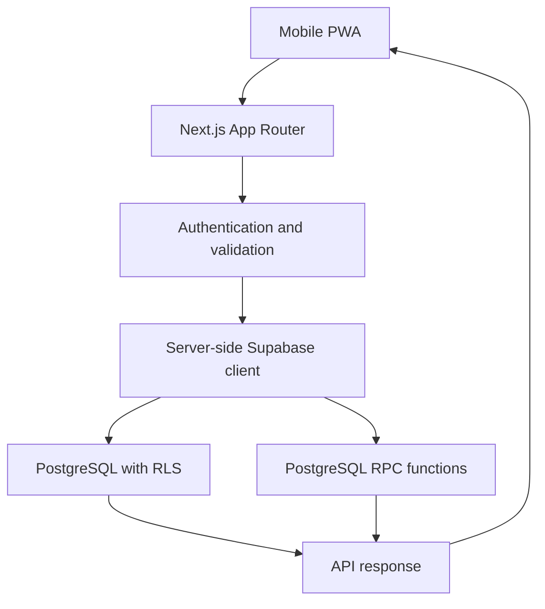

# API Architecture

**Project:** Nomads Pipa  
**Document:** `docs/API_Architecture.md`
**Status:** Draft  
**Stack:** Next.js, TypeScript, Tailwind CSS, shadcn/ui, Supabase

---

## 1. Purpose

This document defines the API architecture for Nomads Pipa.

The API connects the mobile-first PWA to Supabase and supports:

- Public discovery of businesses, events, and services.
- User accounts and profiles.
- Partner applications and business management.
- QR scans and quest progression.
- Voucher issuance and redemption.
- Flash Drop campaigns.
- Partner analytics.

The API must be secure, predictable, and manageable by a solo developer.

## 2. Architecture Overview

Use the Next.js App Router with server-side Route Handlers for operations that need an explicit API contract.

Supabase provides:

- PostgreSQL database.
- Authentication.
- Row Level Security (RLS).
- Storage.
- PostgreSQL functions for atomic operations.

### Request flow



### Core principles

1. The browser must never receive the Supabase service-role key.
2. User permissions must be checked on the server and enforced through RLS.
3. Critical transactions must run atomically in PostgreSQL.
4. QR scans must not automatically grant points or complete quests.
5. Voucher redemption must prevent duplicate use.
6. Business staff must authenticate before accessing the scanner.
7. API responses must use consistent error formats.

## 3. API Conventions

### Base path

Use `/api/v1/` for application API endpoints.

Examples:

- `/api/v1/businesses`
- `/api/v1/events`
- `/api/v1/qr/scan`
- `/api/v1/vouchers/redeem`

### HTTP methods

| Method | Purpose                                   |
| ------ | ----------------------------------------- |
| GET    | Retrieve data                             |
| POST   | Create a resource or perform an operation |
| PATCH  | Update selected fields                    |
| DELETE | Remove a resource when permitted          |

### Response format

Successful responses should follow this structure:

```json
{
  "data": {
    "id": "resource-id"
  },
  "meta": {}
}
```

Error responses:

```json
{
  "error": {
    "code": "VALIDATION_ERROR",
    "message": "The submitted data is invalid.",
    "details": {}
  }
}
```

Do not expose database errors, private records, stack traces, or internal secrets to the browser.

## 4. Authentication and Permissions

Use Supabase Auth for user authentication.

The frontend should use the Supabase session. Server-side operations must validate the current user and use a server-side Supabase client configured with that user's session.

### Permission levels

| Role               | Permissions                                                              |
| ------------------ | ------------------------------------------------------------------------ |
| Public             | Read public listings and published events                                |
| Authenticated user | Manage own profile, scan eligible QR codes, view own quests and vouchers |
| Business staff     | Use assigned business scanner and view permitted operational information |
| Business manager   | Manage business content, offers, and staff permissions                   |
| Business owner     | Manage business account and all business settings                        |
| Platform admin     | Manage platform-wide content and operations                              |

A user may have different roles in different businesses.

Business permissions must come from `business_members`, not from a global user role.

### Important security rules

- Never trust a role or business ID supplied by the browser without checking membership.
- Every business operation must verify that the authenticated user belongs to that business.
- Staff should only access the scanner and the minimum information required to verify a redemption.
- Platform admin privileges must be restricted to trusted administrators.
- Apply RLS to all tables containing user or business-specific data.

## 5. API Endpoint Reference

### 5.1 Authentication and profiles

Supabase Auth handles registration, login, logout, and password recovery.

| Method | Endpoint          | Access        | Purpose             |
| ------ | ----------------- | ------------- | ------------------- |
| GET    | `/api/v1/profile` | Authenticated | Get current profile |
| PATCH  | `/api/v1/profile` | Authenticated | Update own profile  |

Example profile update:

```json
{
  "display_name": "Alex",
  "preferred_language": "en"
}
```

The server must ignore or reject attempts to update protected fields such as:

- `id`
- `platform_role`
- `created_at`
- Other users' profile data

### 5.2 Business directory

| Method | Endpoint                        | Access           | Purpose                    |
| ------ | ------------------------------- | ---------------- | -------------------------- |
| GET    | `/api/v1/businesses`            | Public           | List published businesses  |
| GET    | `/api/v1/businesses/:id`        | Public           | View business details      |
| POST   | `/api/v1/business-applications` | Public           | Submit partner application |
| GET    | `/api/v1/business/dashboard`    | Business member  | Get business dashboard     |
| PATCH  | `/api/v1/businesses/:id`        | Manager or owner | Update business details    |

Business listings should support:

- Category filtering.
- Tag filtering.
- Search by name.
- Featured listings.
- Pagination.
- Published status.

Example:

`GET /api/v1/businesses?category=restaurants&limit=20&cursor=...`

Public endpoints must return only published and publicly visible fields.

### 5.3 Accommodation enquiries

| Method | Endpoint                              | Access                    | Purpose                      |
| ------ | ------------------------------------- | ------------------------- | ---------------------------- |
| POST   | `/api/v1/accommodation-enquiries`     | Authenticated             | Submit accommodation request |
| GET    | `/api/v1/accommodation-enquiries/:id` | Owner or authorised admin | View enquiry status          |

Example request:

```json
{
  "check_in": "2026-12-01",
  "check_out": "2026-12-10",
  "guest_count": 2,
  "accommodation_type": "apartment",
  "budget_range": "medium",
  "notes": "Looking for a place with reliable Wi-Fi."
}
```

Validate dates, guest count, and required fields on the server.

Do not expose one user's enquiry to another user.

### 5.4 QR scan validation

QR scanning is a core Traffic Router operation.

| Method | Endpoint              | Access                                   | Purpose          |
| ------ | --------------------- | ---------------------------------------- | ---------------- |
| POST   | `/api/v1/qr/scan`     | Authenticated user                       | Submit a scan    |
| GET    | `/api/v1/qr/scan/:id` | Scan owner or authorised business member | View scan result |

A QR scan should identify the QR code and record the scan event. It must not automatically grant points, issue a voucher, or complete a quest.

Those outcomes depend on separate eligibility rules.

Example request:

```json
{
  "qr_token": "opaque-signed-token",
  "idempotency_key": "client-generated-unique-id",
  "location": {
    "latitude": -6.23,
    "longitude": -35.05,
    "accuracy_meters": 30
  }
}
```

Location is optional. If supplied, treat it as a verification signal rather than definitive proof of physical presence.

The server must:

1. Authenticate the user.
2. Validate the QR token.
3. Check whether the QR code is active and within its validity period.
4. Check scan eligibility and relevant business rules.
5. Check for duplicate requests using the idempotency key.
6. Record the scan event.
7. Return the result without assuming quest completion.

Example response:

```json
{
  "data": {
    "scan_id": "scan-123",
    "status": "accepted",
    "business_name": "Partner Business",
    "next_action": "check_quest_progress"
  }
}
```

Possible statuses:

- `accepted`
- `already_scanned`
- `expired`
- `invalid`
- `not_eligible`
- `rejected`

The response must not reveal sensitive fraud-detection rules.

### 5.5 Quest progression

| Method | Endpoint                   | Access                                           | Purpose               |
| ------ | -------------------------- | ------------------------------------------------ | --------------------- |
| GET    | `/api/v1/quests`           | Public or authenticated, according to visibility | List available quests |
| GET    | `/api/v1/quests/:id`       | Public or authenticated, according to visibility | View quest details    |
| POST   | `/api/v1/quests/:id/start` | Authenticated                                    | Start a quest         |
| GET    | `/api/v1/quests/progress`  | Authenticated                                    | View own progress     |

Quest completion should be evaluated server-side.

A scan may satisfy a quest step only when:

- The scan is valid.
- The relevant QR code is linked to that step.
- The user meets the step's eligibility rules.
- The step has not already been completed.

The completion operation should update quest progress and any associated reward in a single transaction.

Do not allow the browser to submit an arbitrary `completed: true` value.

### 5.6 Voucher issuance and redemption

| Method | Endpoint                  | Access                       | Purpose                 |
| ------ | ------------------------- | ---------------------------- | ----------------------- |
| GET    | `/api/v1/vouchers`        | Authenticated                | View own voucher wallet |
| GET    | `/api/v1/vouchers/:id`    | Voucher owner                | View voucher details    |
| POST   | `/api/v1/vouchers/redeem` | Authenticated business staff | Redeem a user's voucher |

Example redemption request:

```json
{
  "voucher_token": "opaque-voucher-token",
  "idempotency_key": "unique-redemption-request"
}
```

The server must verify:

- The staff member is authenticated.
- The staff member belongs to the voucher's business.
- The voucher is valid and belongs to the correct user.
- The voucher has not expired.
- The voucher has not already been redeemed.
- The voucher is eligible for redemption at that business.

The redemption must be performed through an atomic database function or transaction.

A successful response:

```json
{
  "data": {
    "redemption_id": "redemption-123",
    "status": "redeemed",
    "voucher_name": "Welcome Discount",
    "redeemed_at": "2026-11-02T12:00:00Z"
  }
}
```

The database must prevent duplicate redemption even if two requests arrive simultaneously.

### 5.7 Staff scanner

The scanner should be a simplified, mobile-friendly interface.

Staff must authenticate using a staff account. The interface can be separate from the main consumer navigation, but it must not be an unauthenticated public redemption tool.

Recommended route:

`/staff/scanner`

The scanner should:

1. Authenticate the staff member.
2. Load the staff member's permitted business.
3. Scan a voucher or user QR code.
4. Submit the token to the server.
5. Display a clear valid, invalid, expired, or already-used result.
6. Record the redemption or scan event.

Staff should not be able to browse user profiles, unrelated vouchers, or business analytics unless separately authorised.

### 5.8 Flash Drops

| Method | Endpoint                        | Access                    | Purpose                  |
| ------ | ------------------------------- | ------------------------- | ------------------------ |
| POST   | `/api/v1/business/flash-drops`  | Business manager or owner | Create a Flash Drop      |
| GET    | `/api/v1/flash-drops`           | Authenticated user        | Discover eligible offers |
| GET    | `/api/v1/flash-drops/:id`       | Authenticated user        | View offer details       |
| POST   | `/api/v1/flash-drops/:id/claim` | Authenticated user        | Claim an offer           |

A Flash Drop may include:

- Offer description.
- Discount or reward.
- Start and expiry time.
- Maximum number of claims.
- Optional geographic targeting radius.
- Eligible user segment.

For the MVP, the first-10-users rule must be enforced in the database, not in frontend code.

The claim operation must be atomic:

1. Check that the Flash Drop is active.
2. Check that it has not expired.
3. Check that the user is eligible.
4. Check that the user has not already claimed it.
5. Check that the claim limit has not been reached.
6. Create the claim and increment the claim count in one transaction.

If the claim limit is reached, return:

```json
{
  "error": {
    "code": "FLASH_DROP_FULL",
    "message": "This offer has already been claimed."
  }
}
```

GPS-based proximity is an eligibility signal and should not be treated as tamper-proof.

### 5.9 Partner analytics

| Method | Endpoint                              | Access                    | Purpose             |
| ------ | ------------------------------------- | ------------------------- | ------------------- |
| GET    | `/api/v1/business/analytics/overview` | Business manager or owner | Summary metrics     |
| GET    | `/api/v1/business/analytics/scans`    | Business manager or owner | Scan activity       |
| GET    | `/api/v1/business/analytics/vouchers` | Business manager or owner | Voucher performance |
| GET    | `/api/v1/business/analytics/quests`   | Business manager or owner | Quest participation |

Suggested metrics:

- Total QR scans.
- Accepted scans.
- Unique users.
- Quest completions associated with the business.
- Vouchers issued.
- Vouchers redeemed.
- Flash Drop claims.
- Redemption rate.

Analytics must be scoped to the authenticated user's business membership.

Avoid exposing personally identifiable user data when aggregated metrics are sufficient.

## 6. Server-Side Implementation

### Recommended project structure

```text
src/
  app/
    api/
      v1/
        profile/
        businesses/
        business-applications/
        accommodation-enquiries/
        qr/
          scan/
        quests/
        vouchers/
          redeem/
        flash-drops/
        business/
          analytics/
    staff/
      scanner/
  lib/
    supabase/
      client.ts
      server.ts
    auth/
      permissions.ts
    validation/
      schemas.ts
    api/
      responses.ts
      errors.ts
  types/
    api.ts
    database.ts
```

### Route Handler example

```typescript
// src/app/api/v1/profile/route.ts

import { NextResponse } from "next/server";
import { createClient } from "@/lib/supabase/server";

export async function GET() {
  const supabase = await createClient();

  const {
    data: { user },
    error: authError,
  } = await supabase.auth.getUser();

  if (authError || !user) {
    return NextResponse.json(
      {
        error: {
          code: "UNAUTHORIZED",
          message: "Authentication required.",
        },
      },
      { status: 401 }
    );
  }

  const { data, error } = await supabase
    .from("profiles")
    .select("id, display_name, preferred_language, avatar_url")
    .eq("id", user.id)
    .single();

  if (error) {
    return NextResponse.json(
      {
        error: {
          code: "PROFILE_NOT_FOUND",
          message: "Profile could not be found.",
        },
      },
      { status: 404 }
    );
  }

  return NextResponse.json({ data });
}
```

Use the same pattern for other user-specific endpoints, adapting validation and permissions to each operation.

## 7. Validation

Use Zod for request validation.

Example:

```typescript
import { z } from "zod";

export const qrScanSchema = z.object({
  qr_token: z.string().min(1).max(2048),
  idempotency_key: z.string().uuid(),
  location: z
    .object({
      latitude: z.number().min(-90).max(90),
      longitude: z.number().min(-180).max(180),
      accuracy_meters: z.number().positive().max(10000),
    })
    .optional(),
});
```

Validation must happen on the server, even when the frontend also validates the form.

Set reasonable request body limits and reject unexpected fields for sensitive operations.

## 8. Database Transactions and Idempotency

Use PostgreSQL functions for operations where partial completion would create inconsistent data.

Priority operations:

- QR scan recording.
- Quest step completion.
- Point awarding.
- Voucher redemption.
- Flash Drop claiming.

Each operation should have a unique idempotency key or equivalent database constraint.

For example:

```sql
CREATE UNIQUE INDEX scan_events_user_idempotency_idx
ON scan_events (user_id, idempotency_key);
```

A repeated request should return the original result where appropriate, rather than creating another scan, reward, or redemption.

Do not rely on frontend button disabling to prevent duplicate operations.

## 9. Security and Abuse Prevention

### Required controls

- Supabase Auth for authenticated actions.
- RLS for user and business data.
- Server-side business membership checks.
- Zod validation for all request bodies.
- Rate limiting on scans, claims, login-related operations, and public enquiry forms.
- Idempotency on transactional endpoints.
- Audit logging for important partner actions.
- Secure, opaque QR and voucher tokens.
- Token expiry and revocation.
- No service-role credentials in browser code.
- No sensitive user information in QR payloads.

### QR token design

QR codes should contain an opaque token or signed reference, not a user's personal information.

For reusable physical business QR codes, the QR identifies the business or quest location. The authenticated user is identified by their session.

For personal voucher QR codes, the token should identify the voucher securely and should not expose the voucher's internal database ID as the only security mechanism.

Static QR codes can be copied. GPS checks, scan limits, staff verification, and server-side eligibility rules can reduce abuse but cannot guarantee physical presence.

## 10. Pagination and Filtering

Use cursor-based pagination for larger lists.

Example:

`GET /api/v1/businesses?limit=20&cursor=eyJpZCI6...`

Default:

- Limit: 20.
- Maximum limit: 50.
- Stable sorting.
- Cursor based on a stable sort key.

Do not load the full directory or all scan history into the browser.

## 11. Time and Localisation

Use UTC timestamps in the database and API responses.

Use `America/Fortaleza` for displaying local Pipa times and evaluating local event schedules.

Store user language preferences in the profile.

The initial supported languages should be English and Portuguese, with translation managed through the application content layer.

## 12. Testing Requirements

### Unit tests

- Request validation.
- Permission helpers.
- Quest eligibility rules.
- Voucher expiry rules.
- Flash Drop eligibility rules.

### Integration tests

- Unauthenticated users cannot access protected endpoints.
- Users cannot read another user's vouchers.
- Staff cannot redeem vouchers for an unrelated business.
- Business managers cannot access another business's analytics.
- Duplicate QR requests do not create duplicate records.
- Quest steps cannot be completed without valid conditions.
- Voucher redemption cannot happen twice.
- Flash Drop claim limits cannot be exceeded.

### End-to-end tests

- User signs in and views the directory.
- User scans a valid QR code.
- Quest progress updates after a qualifying scan.
- User receives an eligible voucher.
- Staff signs in and redeems the voucher.
- Business owner creates a Flash Drop.
- Eligible users can claim it until the limit is reached.

## 13. Implementation Order

Build the API in this order to reduce dependencies:

| Phase | Endpoints and capabilities                   |
| ----- | -------------------------------------------- |
| 1     | Profile, public businesses, public events    |
| 2     | Partner applications and business management |
| 3     | QR scan recording and validation             |
| 4     | Quest progression and rewards                |
| 5     | Voucher wallet and staff redemption          |
| 6     | Flash Drop creation and claims               |
| 7     | Partner analytics                            |
| 8     | Accommodation and concierge enquiries        |

Do not build every endpoint before testing the consumer and partner workflows. Implement each phase with its database policies and tests.

## 14. Definition of Done

The API architecture is ready for MVP when:

- Public endpoints expose only published public data.
- Authenticated endpoints validate the current user.
- Business operations enforce membership and role permissions.
- RLS is enabled and tested for relevant tables.
- QR scans are recorded without automatically granting rewards.
- Quest progression is evaluated server-side.
- Voucher redemption is atomic and cannot be duplicated.
- Flash Drop limits are enforced transactionally.
- Staff scanner access is authenticated and restricted.
- Analytics are scoped to the correct business.
- Errors use a consistent response format.
- Critical endpoints have integration tests.
- No service-role secret is exposed to the client.

---
