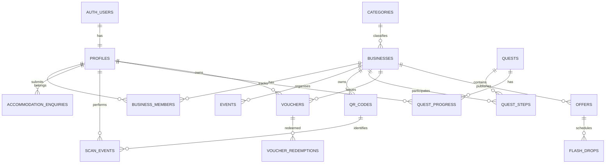

# Nomads Pipa — Database Architecture

**File:** `docs/DATABASE.md`
**Version:** 1.0  
**Status:** Draft  
**Database:** Supabase PostgreSQL  
**Backend:** Supabase  
**Application:** Next.js + TypeScript

---

# 1. Purpose

This document defines the database structure for Nomads Pipa.

It covers:

- User profiles and authentication.
- Business listings and partner accounts.
- Directory categories.
- Events and community content.
- Accommodation enquiries.
- QR codes and scan history.
- Quests and gamification.
- Vouchers and redemption.
- Offers and Flash Drops.
- Analytics and audit history.
- Database security and Row Level Security (RLS).

The database must support both the public discovery platform and the more advanced Traffic Router ecosystem.

## 1.1 Database design principles

1. **PostgreSQL as the source of truth:** All important business records must be stored in the database.
2. **Relational structure:** Use foreign keys and constraints to maintain data integrity.
3. **Secure by default:** Protected tables must use Row Level Security.
4. **Server-side business rules:** Reward issuance and voucher redemption must not depend on browser-side logic.
5. **Auditability:** Important user and business actions must be traceable.
6. **Incremental development:** Create tables as their corresponding features are implemented.
7. **Avoid unnecessary duplication:** Store information once and reference it where appropriate.
8. **Operational simplicity:** Prefer standard PostgreSQL features over unnecessary third-party infrastructure.

---

# 2. Supabase Database Structure

Supabase provides PostgreSQL as the primary database.

The application will use:

- `auth.users` for authentication identities.
- `public` schema for application data.
- Supabase Storage for uploaded files.
- PostgreSQL functions for trusted database operations where appropriate.
- RLS policies to enforce access permissions.

## 2.1 Relationship overview



This is a conceptual overview. The complete database will include additional relationships and constraints.

---

# 3. Authentication & User Profiles

## 3.1 `auth.users`

Supabase Auth manages the underlying authentication identity.

Do not duplicate passwords or authentication credentials in the application database.

The application should reference the Supabase Auth user ID.

## 3.2 `profiles`

Stores application-specific user information.

| Column               | Type           | Description                                           |
| -------------------- | -------------- | ----------------------------------------------------- |
| id                   | UUID, PK       | References `auth.users.id`.                           |
| display_name         | TEXT           | User's preferred name.                                |
| avatar_url           | TEXT, nullable | Profile image.                                        |
| email                | TEXT, nullable | Optional display/contact field.                       |
| phone                | TEXT, nullable | Optional phone number.                                |
| country              | TEXT, nullable | Country of origin or residence.                       |
| profile_type         | TEXT           | Visitor, resident, or other supported classification. |
| platform_role        | TEXT           | `user` or `admin`.                                    |
| preferred_language   | TEXT           | Initial default: `en`.                                |
| onboarding_completed | BOOLEAN        | Whether onboarding is complete.                       |
| created_at           | TIMESTAMPTZ    | Creation timestamp.                                   |
| updated_at           | TIMESTAMPTZ    | Last update timestamp.                                |

### Important rules

- `id` must reference `auth.users.id`.
- New profiles should receive `platform_role = 'user'`.
- Only trusted administrative processes may assign `admin`.
- Users may update their own permitted profile fields.
- Users must not be able to update their own platform role.

**Architecture clarification:** Partner and staff access should not be represented as global platform roles. These permissions belong to business memberships, because one user may be a manager at one business and staff at another.

### SQL

```sql
create table public.profiles (
    id uuid primary key references auth.users(id)
        on delete cascade,

    display_name text,
    avatar_url text,
    email text,
    phone text,
    country text,

    profile_type text not null default 'visitor'
        check (profile_type in ('visitor', 'resident', 'other')),

    platform_role text not null default 'user'
        check (platform_role in ('user', 'admin')),

    preferred_language text not null default 'en',
    onboarding_completed boolean not null default false,

    created_at timestamptz not null default now(),
    updated_at timestamptz not null default now()
);
```

Create a trusted profile creation trigger or server-side workflow for new authentication users. The profile role must never be copied from an unrestricted user-supplied metadata field.

---

# 4. Businesses & Partner Management

## 4.1 `businesses`

Stores all business and service listings.

A business can be publicly listed without being a paid partner.

| Column          | Type              | Description                                |
| --------------- | ----------------- | ------------------------------------------ |
| id              | UUID, PK          | Business identifier.                       |
| name            | TEXT              | Business name.                             |
| slug            | TEXT, UNIQUE      | Public URL identifier.                     |
| description     | TEXT              | Business description.                      |
| category_id     | UUID, FK          | Primary category.                          |
| address         | TEXT              | Display address.                           |
| latitude        | NUMERIC, nullable | Latitude.                                  |
| longitude       | NUMERIC, nullable | Longitude.                                 |
| whatsapp        | TEXT, nullable    | WhatsApp contact.                          |
| phone           | TEXT, nullable    | Telephone.                                 |
| website         | TEXT, nullable    | Website.                                   |
| instagram       | TEXT, nullable    | Instagram URL or handle.                   |
| cover_image_url | TEXT, nullable    | Main image.                                |
| logo_url        | TEXT, nullable    | Business logo.                             |
| opening_hours   | JSONB             | Structured opening hours.                  |
| price_level     | TEXT, nullable    | Optional price classification.             |
| listing_status      | TEXT              | Draft, pending review, published, archived.|
| partner_status      | TEXT              | Non-partner, pending, approved, suspended. |
| verification_status | TEXT              | Unverified, pending verification, verified.|
| visibility          | TEXT              | Public, members only, hidden.              |
| created_at          | TIMESTAMPTZ       | Creation timestamp.                        |
| updated_at          | TIMESTAMPTZ       | Last update timestamp.                     |

### Important rules

- `slug` must be unique.
- Only published listings with public visibility should be visible publicly.
- Partner status, listing status, verification status, and audience visibility are strictly decoupled concepts.
- An approved partner does not automatically mean every business detail is verified.
- Location coordinates should be validated before publication.

### SQL

```sql
create table public.businesses (
    id uuid primary key default gen_random_uuid(),

    name text not null,
    slug text not null unique,
    description text,

    category_id uuid references public.categories(id),
    subcategory text,

    address text,
    latitude numeric(10, 7),
    longitude numeric(10, 7),

    whatsapp text,
    phone text,
    email text,
    website text,
    instagram text,

    cover_image_url text,
    logo_url text,
    opening_hours jsonb not null default '{}'::jsonb,

    price_level text check (price_level is null or price_level in ('$', '$$', '$$$', '$$$$')),

    listing_status text not null default 'draft'
        check (listing_status in ('draft', 'pending_review', 'published', 'archived')),

    partner_status text not null default 'none'
        check (partner_status in ('none', 'pending', 'approved', 'suspended')),

    verification_status text not null default 'unverified'
        check (verification_status in ('unverified', 'pending_verification', 'verified')),

    visibility text not null default 'public'
        check (visibility in ('public', 'members_only', 'hidden')),

    has_wifi boolean not null default false,
    has_power_outlets boolean not null default false,
    is_pet_friendly boolean not null default false,
    is_demo boolean not null default false,

    created_at timestamptz not null default now(),
    updated_at timestamptz not null default now(),

    check (
        latitude is null or latitude between -90 and 90
    ),

    check (
        longitude is null or longitude between -180 and 180
    )
);
```

The `categories` table is defined in Section 5.

## 4.2 `business_members`

Connects authenticated users to businesses.

A business can have multiple members, and a user can belong to multiple businesses.

| Column      | Type        | Description                  |
| ----------- | ----------- | ---------------------------- |
| id          | UUID, PK    | Membership identifier.       |
| business_id | UUID, FK    | Associated business.         |
| user_id     | UUID, FK    | Associated profile.          |
| role        | TEXT        | Owner, manager, or staff.    |
| status      | TEXT        | Pending, active, or revoked. |
| created_at  | TIMESTAMPTZ | Creation timestamp.          |

### SQL

```sql
create table public.business_members (
    id uuid primary key default gen_random_uuid(),

    business_id uuid not null references public.businesses(id)
        on delete cascade,

    user_id uuid not null references public.profiles(id)
        on delete cascade,

    role text not null
        check (role in ('owner', 'manager', 'staff')),

    status text not null default 'active'
        check (status in ('pending', 'active', 'revoked')),

    created_at timestamptz not null default now(),

    unique (business_id, user_id)
);
```

### Permissions

| Role    | Permissions                                       |
| ------- | ------------------------------------------------- |
| Owner   | Full management of assigned business.             |
| Manager | Manage listings, offers, and permitted reporting. |
| Staff   | Access assigned redemption functionality.         |

The exact permission matrix should be implemented in server-side authorisation logic and database policies.

Staff must not automatically receive access to partner analytics or business settings.

## 4.3 `partner_applications`

Stores applications submitted through the Become a Partner page.

| Column        | Type                  | Description                  |
| ------------- | --------------------- | ---------------------------- |
| id            | UUID, PK              | Application ID.              |
| business_name | TEXT                  | Submitted business name.     |
| contact_name  | TEXT                  | Applicant.                   |
| email         | TEXT                  | Contact email.               |
| whatsapp      | TEXT                  | Contact number.              |
| category      | TEXT                  | Business category.           |
| location      | TEXT                  | Business location.           |
| website       | TEXT, nullable        | Website.                     |
| social_url    | TEXT, nullable        | Social profile.              |
| message       | TEXT, nullable        | Additional information.      |
| status        | TEXT                  | Pending, approved, rejected. |
| reviewed_by   | UUID, nullable        | Admin profile.               |
| reviewed_at   | TIMESTAMPTZ, nullable | Review timestamp.            |
| created_at    | TIMESTAMPTZ           | Submission timestamp.        |

Applications should initially be managed manually by administrators.

Approval should create or associate a business record and establish the appropriate business membership.

Do not automatically grant partner access just because a form was submitted.

---

# 5. Directory & Content

## 5.1 `categories`

Stores the platform's discovery categories.

| Column        | Type           | Description                 |
| ------------- | -------------- | --------------------------- |
| id            | UUID, PK       | Category identifier.        |
| name          | TEXT           | Category name.              |
| slug          | TEXT, UNIQUE   | URL identifier.             |
| description   | TEXT           | Description.                |
| icon          | TEXT, nullable | UI icon identifier.         |
| parent_id     | UUID, nullable | Parent category.            |
| display_order | INTEGER        | Display sequence.           |
| is_active     | BOOLEAN        | Whether category is active. |

Supports hierarchical categories.

Example:

```text
Food & Drink
    Restaurants
    Cafes
    Bars
    Delivery

Sports & Activities
    Surf
    Yoga
    Gyms
    Padel
```

### SQL

```sql
create table public.categories (
    id uuid primary key default gen_random_uuid(),

    name text not null,
    slug text not null unique,
    description text,
    icon text,

    parent_id uuid references public.categories(id),

    display_order integer not null default 0,
    is_active boolean not null default true,

    created_at timestamptz not null default now()
);
```

## 5.2 `business_tags`

Stores contextual discovery tags.

Examples:

- Remote Work.
- Wi-Fi.
- Sunset View.
- Vegan.
- Live Music.
- Daily Meal.
- Cold Beer.
- Date Spot.

| Column | Type         | Description     |
| ------ | ------------ | --------------- |
| id     | UUID, PK     | Tag identifier. |
| name   | TEXT         | Display name.   |
| slug   | TEXT, UNIQUE | URL identifier. |

## 5.3 `business_tag_assignments`

Many-to-many relationship between businesses and tags.

| Column      | Type     | Description |
| ----------- | -------- | ----------- |
| business_id | UUID, FK | Business.   |
| tag_id      | UUID, FK | Tag.        |

```sql
create table public.business_tags (
    id uuid primary key default gen_random_uuid(),
    name text not null,
    slug text not null unique
);

create table public.business_tag_assignments (
    business_id uuid not null references public.businesses(id)
        on delete cascade,

    tag_id uuid not null references public.business_tags(id)
        on delete cascade,

    primary key (business_id, tag_id)
);
```

## 5.4 `events`

Stores official meetups, community picks, and general city events.

| Column            | Type           | Description                            |
| ----------------- | -------------- | -------------------------------------- |
| id                | UUID, PK       | Event identifier.                      |
| title             | TEXT           | Event name.                            |
| slug              | TEXT, UNIQUE   | URL identifier.                        |
| description       | TEXT           | Event information.                     |
| event_type        | TEXT           | Official, community pick, city event.  |
| business_id       | UUID, nullable | Associated business.                   |
| location_name     | TEXT           | Venue.                                 |
| address           | TEXT, nullable | Address.                               |
| starts_at         | TIMESTAMPTZ    | Start time.                            |
| ends_at           | TIMESTAMPTZ    | End time.                              |
| image_url         | TEXT, nullable | Event image.                           |
| external_url      | TEXT, nullable | Booking or information link.           |
| price_description | TEXT, nullable | Cost information.                      |
| status            | TEXT           | Draft, published, cancelled, archived. |
| created_by        | UUID           | Creator.                               |
| created_at        | TIMESTAMPTZ    | Creation timestamp.                    |

### SQL

```sql
create table public.events (
    id uuid primary key default gen_random_uuid(),

    title text not null,
    slug text not null unique,
    description text,

    event_type text not null
        check (event_type in (
            'official_meetup',
            'community_pick',
            'city_event'
        )),

    business_id uuid references public.businesses(id),

    location_name text,
    address text,

    starts_at timestamptz not null,
    ends_at timestamptz,

    image_url text,
    external_url text,
    price_description text,

    status text not null default 'draft'
        check (status in (
            'draft',
            'published',
            'cancelled',
            'archived'
        )),

    created_by uuid references public.profiles(id),

    created_at timestamptz not null default now(),

    check (ends_at is null or ends_at >= starts_at)
);
```

Event timestamps should be stored as `TIMESTAMPTZ` and displayed in the appropriate local timezone.

For Pipa, the display timezone should be `America/Fortaleza`.

## 5.5 `posts`

Stores blog and editorial content.

| Column          | Type          | Description         |
| --------------- | ------------- | ------------------- |
| id              | UUID, PK      | Post identifier.    |
| title           | TEXT          | Article title.      |
| slug            | TEXT, UNIQUE  | URL identifier.     |
| excerpt         | TEXT          | Summary.            |
| content         | JSONB or TEXT | Article body.       |
| cover_image_url | TEXT          | Main image.         |
| status          | TEXT          | Draft or published. |
| published_at    | TIMESTAMPTZ   | Publication date.   |
| author_id       | UUID          | Author.             |

For rich editorial formatting, use a consistent structured content format rather than storing arbitrary HTML from untrusted sources.

If using a rich text editor, document its output format and renderer so formatting remains consistent after publishing.

## 5.6 Localisation strategy

The initial release can store English content as the default.

For content requiring translations, use explicit language fields or a separate translation table.

Recommended future structure:

```text
business_translations
    id
    business_id
    language_code
    name
    description

event_translations
    id
    event_id
    language_code
    title
    description
```

Do not build a full translation management system until Portuguese localisation is ready to be implemented.

---

# 6. Enquiries & Concierge

## 6.1 `accommodation_enquiries`

Stores requests for accommodation quotes.

| Column             | Type           | Description                            |
| ------------------ | -------------- | -------------------------------------- |
| id                 | UUID, PK       | Enquiry ID.                            |
| user_id            | UUID, nullable | Authenticated user.                    |
| contact_name       | TEXT           | Customer name.                         |
| email              | TEXT           | Contact email.                         |
| whatsapp           | TEXT           | Contact number.                        |
| check_in           | DATE           | Arrival date.                          |
| check_out          | DATE           | Departure date.                        |
| guest_count        | INTEGER        | Number of guests.                      |
| accommodation_type | TEXT           | Requested type.                        |
| budget_description | TEXT           | Approximate budget.                    |
| requirements       | TEXT           | Additional requirements.               |
| status             | TEXT           | New, processing, completed, cancelled. |
| created_at         | TIMESTAMPTZ    | Submission time.                       |

Enquiries may be submitted without an account, but public submission must be protected against spam and abuse.

## 6.2 `concierge_enquiries`

Stores personalised assistance requests.

Suggested fields:

- User ID, nullable.
- Name.
- Email.
- WhatsApp.
- Requested package.
- Message.
- Status.
- Assigned team member.
- Created timestamp.

For the MVP, concierge fulfilment can remain manual.

## 6.3 `accommodation_enquiry_partners`

Optional future table for routing an enquiry to multiple partners.

Do not introduce automated partner matching until the manual enquiry process has been validated.

---

# 7. Quests & Gamification

The gamification system should be built from independent records for quest definitions, requirements, progress, and completion.

## 7.1 `quests`

Stores quest definitions.

| Column             | Type              | Description                         |
| ------------------ | ----------------- | ----------------------------------- |
| id                 | UUID, PK          | Quest ID.                           |
| title              | TEXT              | Quest name.                         |
| slug               | TEXT, UNIQUE      | Identifier.                         |
| description        | TEXT              | Quest information.                  |
| reward_description | TEXT              | Displayed reward.                   |
| status             | TEXT              | Draft, active, completed, archived. |
| starts_at          | TIMESTAMPTZ       | Start date.                         |
| ends_at            | TIMESTAMPTZ       | End date.                           |
| max_completions    | INTEGER, nullable | Optional global limit.              |
| created_at         | TIMESTAMPTZ       | Creation timestamp.                 |

## 7.2 `quest_steps`

Defines the requirements for a quest.

| Column         | Type           | Description                             |
| -------------- | -------------- | --------------------------------------- |
| id             | UUID, PK       | Step ID.                                |
| quest_id       | UUID, FK       | Parent quest.                           |
| business_id    | UUID, nullable | Required business.                      |
| step_type      | TEXT           | Visit, scan, or other supported action. |
| description    | TEXT           | Step description.                       |
| required_count | INTEGER        | Required number of completions.         |
| display_order  | INTEGER        | Sequence.                               |

For the initial release, use simple quest requirements based on validated partner visit events.

Avoid complex branching quest definitions initially.

## 7.3 `quest_progress`

Tracks an individual user's progress.

| Column         | Type                  | Description                      |
| -------------- | --------------------- | -------------------------------- |
| id             | UUID, PK              | Progress ID.                     |
| quest_id       | UUID, FK              | Quest.                           |
| user_id        | UUID, FK              | User.                            |
| progress_count | INTEGER               | Current progress.                |
| status         | TEXT                  | In progress, completed, expired. |
| started_at     | TIMESTAMPTZ           | Start time.                      |
| completed_at   | TIMESTAMPTZ, nullable | Completion time.                 |

Unique constraint:

```sql
unique (quest_id, user_id)
```

A user should normally have one progress record per quest.

If repeatable quests are introduced later, the data model should explicitly support multiple attempts rather than removing this constraint without a replacement.

## 7.4 `quest_step_progress`

Optional table for tracking individual steps.

| Column            | Type                  | Description          |
| ----------------- | --------------------- | -------------------- |
| id                | UUID, PK              | Record ID.           |
| quest_progress_id | UUID, FK              | User quest progress. |
| quest_step_id     | UUID, FK              | Quest requirement.   |
| progress_count    | INTEGER               | Completed count.     |
| completed_at      | TIMESTAMPTZ, nullable | Completion time.     |

This table is recommended when a quest contains multiple distinct requirements.

## 7.5 `gamification_state`

Stores the user's current gamification summary.

| Column              | Type        | Description               |
| ------------------- | ----------- | ------------------------- |
| user_id             | UUID, PK    | User.                     |
| points_balance      | INTEGER     | Current available points. |
| current_level       | INTEGER     | Current level.            |
| total_points_earned | INTEGER     | Lifetime points earned.   |
| updated_at          | TIMESTAMPTZ | Last update.              |

This is a summary table, not the authoritative reward history.

For MVP, points may be deferred if there is no immediate reward use case.

If points are implemented, maintain an immutable points transaction ledger rather than relying only on a mutable balance.

## 7.6 `points_transactions`

Optional ledger for loyalty point changes.

| Column           | Type           | Description                        |
| ---------------- | -------------- | ---------------------------------- |
| id               | UUID, PK       | Transaction ID.                    |
| user_id          | UUID, FK       | User.                              |
| amount           | INTEGER        | Positive or negative change.       |
| transaction_type | TEXT           | Earn, spend, adjustment, reversal. |
| source_type      | TEXT           | Scan, quest, voucher, admin.       |
| source_id        | UUID, nullable | Related record.                    |
| created_at       | TIMESTAMPTZ    | Transaction timestamp.             |

The ledger should be append-only for normal application operations.

A correction should be recorded as a reversal or adjustment rather than silently modifying historical transactions.

---

# 8. QR Codes & Scan History

## 8.1 `qr_codes`

Stores business QR identifiers.

| Column      | Type                  | Description                              |
| ----------- | --------------------- | ---------------------------------------- |
| id          | UUID, PK              | QR record ID.                            |
| business_id | UUID, FK              | Associated business.                     |
| public_id   | UUID, UNIQUE          | Public identifier.                       |
| token_hash  | TEXT, nullable        | Hash of a secret token where applicable. |
| purpose     | TEXT                  | Visit, voucher, campaign.                |
| status      | TEXT                  | Active, disabled, expired.               |
| expires_at  | TIMESTAMPTZ, nullable | Expiry.                                  |
| created_at  | TIMESTAMPTZ           | Creation timestamp.                      |

The QR payload should identify a server-managed record.

If a secret token is used, store only its hash where possible and validate the presented token server-side.

A static printed QR code can be photographed or copied. It must not be treated as strong proof of physical presence.

## 8.2 `scan_events`

This is a critical audit table.

Every scan attempt should be recorded with an outcome, including invalid attempts where practical.

| Column           | Type              | Description                        |
| ---------------- | ----------------- | ---------------------------------- |
| id               | UUID, PK          | Scan event ID.                     |
| user_id          | UUID, nullable    | User attempting the scan.          |
| qr_code_id       | UUID, nullable    | QR record if identified.           |
| business_id      | UUID, nullable    | Associated business if identified. |
| idempotency_key  | UUID              | Unique request identifier.         |
| status           | TEXT              | Valid, invalid, rejected.          |
| rejection_reason | TEXT, nullable    | Reason for rejection.              |
| latitude         | NUMERIC, nullable | Optional location signal.          |
| longitude        | NUMERIC, nullable | Optional location signal.          |
| accuracy_meters  | NUMERIC, nullable | GPS accuracy.                      |
| created_at       | TIMESTAMPTZ       | Attempt timestamp.                 |

### SQL

```sql
create table public.scan_events (
    id uuid primary key default gen_random_uuid(),

    user_id uuid references public.profiles(id),
    qr_code_id uuid references public.qr_codes(id),
    business_id uuid references public.businesses(id),

    idempotency_key uuid not null,

    status text not null
        check (status in ('valid', 'invalid', 'rejected')),

    rejection_reason text,

    latitude numeric(10, 7),
    longitude numeric(10, 7),
    accuracy_meters numeric,

    created_at timestamptz not null default now(),

    unique (user_id, idempotency_key)
);
```

If anonymous scan attempts are supported, use a separate server-generated request identifier and an appropriate uniqueness strategy rather than relying on a nullable user ID in the constraint.

### Important distinction

A `scan_events` record represents a scan attempt and its validation outcome.

It does not automatically represent:

- A completed quest.
- An issued reward.
- A voucher redemption.
- A confirmed purchase.

Those events must have their own records.

---

# 9. Vouchers & Rewards

## 9.1 `vouchers`

Stores individual vouchers issued to users.

| Column       | Type                  | Description                           |
| ------------ | --------------------- | ------------------------------------- |
| id           | UUID, PK              | Voucher ID.                           |
| user_id      | UUID, FK              | Voucher owner.                        |
| business_id  | UUID, FK              | Issuing business.                     |
| quest_id     | UUID, nullable        | Related quest.                        |
| offer_id     | UUID, nullable        | Related offer.                        |
| code_hash    | TEXT                  | Hashed redemption code.               |
| reward_type  | TEXT                  | Discount, free item, special benefit. |
| reward_value | NUMERIC, nullable     | Numeric value if applicable.          |
| description  | TEXT                  | Reward description.                   |
| status       | TEXT                  | Active, redeemed, expired, revoked.   |
| issued_at    | TIMESTAMPTZ           | Issue time.                           |
| expires_at   | TIMESTAMPTZ, nullable | Expiration.                           |
| redeemed_at  | TIMESTAMPTZ, nullable | Redemption time.                      |

The redemption code should be generated using a secure random process.

Avoid storing raw reusable redemption secrets in plaintext.

## 9.2 `voucher_redemptions`

Stores successful redemption transactions.

| Column          | Type        | Description                |
| --------------- | ----------- | -------------------------- |
| id              | UUID, PK    | Redemption ID.             |
| voucher_id      | UUID, FK    | Redeemed voucher.          |
| business_id     | UUID, FK    | Business.                  |
| redeemed_by     | UUID, FK    | Staff member.              |
| idempotency_key | UUID        | Unique request identifier. |
| redeemed_at     | TIMESTAMPTZ | Redemption time.           |

A voucher must only have one successful redemption.

### SQL

```sql
create table public.voucher_redemptions (
    id uuid primary key default gen_random_uuid(),

    voucher_id uuid not null unique
        references public.vouchers(id),

    business_id uuid not null
        references public.businesses(id),

    redeemed_by uuid not null
        references public.profiles(id),

    idempotency_key uuid not null unique,

    redeemed_at timestamptz not null default now()
);
```

The unique constraint on `voucher_id` is an additional database-level safeguard.

The redemption operation must also verify that the voucher belongs to the business and that the staff member has permission to redeem it.

## 9.3 Reward source tracking

Every issued voucher should have an identifiable source.

Examples:

- Quest completion.
- Standard partner visit.
- Flash Drop.
- Golden QR campaign.
- Administrator adjustment.

Store the source type and source identifier where appropriate.

This makes it possible to identify why a user received a reward and measure campaign performance.

## 9.4 Golden QR

Golden QR should use the same underlying QR, reward, and voucher architecture.

The difference should be defined by campaign eligibility and reward configuration.

Do not create a separate voucher system just for Golden QR.

---

# 10. Offers & Flash Drops

## 10.1 `offers`

Stores standard business offers.

| Column           | Type                  | Description                        |
| ---------------- | --------------------- | ---------------------------------- |
| id               | UUID, PK              | Offer ID.                          |
| business_id      | UUID, FK              | Business.                          |
| title            | TEXT                  | Offer title.                       |
| description      | TEXT                  | Offer details.                     |
| reward_type      | TEXT                  | Discount or benefit.               |
| reward_value     | NUMERIC, nullable     | Offer value.                       |
| starts_at        | TIMESTAMPTZ           | Start time.                        |
| ends_at          | TIMESTAMPTZ, nullable | End time.                          |
| redemption_limit | INTEGER, nullable     | Maximum redemptions.               |
| status           | TEXT                  | Draft, active, expired, cancelled. |
| created_at       | TIMESTAMPTZ           | Creation timestamp.                |

## 10.2 `flash_drops`

Stores time-limited promotional campaigns.

| Column          | Type              | Description                                              |
| --------------- | ----------------- | -------------------------------------------------------- |
| id              | UUID, PK          | Campaign ID.                                             |
| offer_id        | UUID, FK          | Associated offer.                                        |
| business_id     | UUID, FK          | Associated business.                                     |
| starts_at       | TIMESTAMPTZ       | Start time.                                              |
| ends_at         | TIMESTAMPTZ       | End time.                                                |
| max_redemptions | INTEGER           | Campaign limit.                                          |
| radius_meters   | INTEGER, nullable | Optional proximity radius.                               |
| status          | TEXT              | Draft, scheduled, active, exhausted, expired, cancelled. |
| created_at      | TIMESTAMPTZ       | Creation timestamp.                                      |

A Flash Drop should reference an offer rather than duplicating all offer information.

The system must enforce the redemption limit inside a trusted database transaction.

## 10.3 Campaign counters

A redemption count may initially be calculated from successful redemption records.

Do not rely on a browser-submitted counter.

If a counter is stored for performance reasons, update it atomically within the same transaction as the successful redemption.

---

# 11. Digital Inventory & Achievements

## 11.1 `achievements`

Stores available digital badges and collectible achievements.

| Column           | Type     | Description                           |
| ---------------- | -------- | ------------------------------------- |
| id               | UUID, PK | Achievement ID.                       |
| name             | TEXT     | Achievement name.                     |
| description      | TEXT     | Description.                          |
| image_url        | TEXT     | Artwork.                              |
| achievement_type | TEXT     | Badge, quest completion, collectible. |
| is_active        | BOOLEAN  | Availability.                         |

## 11.2 `user_achievements`

Stores achievements unlocked by users.

| Column         | Type           | Description                     |
| -------------- | -------------- | ------------------------------- |
| id             | UUID, PK       | Record ID.                      |
| user_id        | UUID, FK       | User.                           |
| achievement_id | UUID, FK       | Achievement.                    |
| unlocked_at    | TIMESTAMPTZ    | Unlock time.                    |
| source_type    | TEXT           | Quest, campaign, administrator. |
| source_id      | UUID, nullable | Related record.                 |

Unique constraint:

```sql
unique (user_id, achievement_id)
```

The initial implementation can be simple: users unlock artwork when they complete defined activities.

No blockchain or NFT infrastructure is required.

---

# 12. Audit Logs

## 12.1 `audit_logs`

Stores important administrative and system actions.

| Column      | Type           | Description                     |
| ----------- | -------------- | ------------------------------- |
| id          | UUID, PK       | Log ID.                         |
| actor_id    | UUID, nullable | User performing action.         |
| action      | TEXT           | Action name.                    |
| entity_type | TEXT           | Affected resource type.         |
| entity_id   | UUID, nullable | Affected record.                |
| metadata    | JSONB          | Relevant non-sensitive context. |
| created_at  | TIMESTAMPTZ    | Event time.                     |

Example actions:

- `partner.approved`
- `partner.rejected`
- `business.updated`
- `quest.created`
- `reward.issued`
- `voucher.redeemed`
- `staff.access_revoked`
- `offer.activated`

Audit records should be append-only for normal application access.

Do not store passwords, session tokens, raw QR secrets, or unnecessary personal information in audit metadata.

---

# 13. Database Indexing

Indexes should support the queries the application actually performs.

Recommended initial indexes:

```sql
-- Business discovery
create index idx_businesses_category
on public.businesses(category_id);

create index idx_businesses_status
on public.businesses(listing_status);

create index idx_businesses_partner_status
on public.businesses(partner_status);

-- Business memberships
create index idx_business_members_user
on public.business_members(user_id, status);

create index idx_business_members_business
on public.business_members(business_id, status);

-- Events
create index idx_events_starts_at
on public.events(starts_at);

create index idx_events_status
on public.events(status);

-- QR scans
create index idx_scan_events_user
on public.scan_events(user_id, created_at desc);

create index idx_scan_events_business
on public.scan_events(business_id, created_at desc);

-- Quests
create index idx_quest_progress_user
on public.quest_progress(user_id, status);

-- Vouchers
create index idx_vouchers_user_status
on public.vouchers(user_id, status);

create index idx_vouchers_business
on public.vouchers(business_id);

-- Redemptions
create index idx_redemptions_business_date
on public.voucher_redemptions(business_id, redeemed_at desc);

-- Offers
create index idx_offers_business_status
on public.offers(business_id, status);
```

Do not add indexes to every column.

Indexes should be reviewed against query patterns and actual database performance.

---

# 14. Row Level Security (RLS)

RLS is mandatory for protected application tables.

The application should use both:

1. Server-side authorisation.
2. Database-level RLS.

Neither replaces the other.

## 14.1 General access model

| Data                 | Public            | Authenticated user   | Business member                      | Admin             |
| -------------------- | ----------------- | -------------------- | ------------------------------------ | ----------------- |
| Published businesses | Read              | Read                 | Read                                 | Full              |
| Draft businesses     | No                | No                   | Assigned business only               | Full              |
| Published events     | Read              | Read                 | Read                                 | Full              |
| Profiles             | No general access | Own profile          | Own profile                          | Controlled access |
| Partner applications | Submit            | Own application      | No general access                    | Full              |
| Business memberships | No                | Own membership       | Assigned business scope              | Full              |
| Scan events          | No                | Own records          | Assigned business reporting          | Full              |
| Vouchers             | No                | Own vouchers         | Assigned business redemption context | Controlled access |
| Redemptions          | No                | Own eligible history | Assigned business                    | Full              |
| Quests               | Active quests     | Active quests        | Assigned participation context       | Full              |

Public access should only expose the fields required by the public interface.

## 14.2 Enable RLS

Example:

```sql
alter table public.profiles enable row level security;
alter table public.businesses enable row level security;
alter table public.business_members enable row level security;
alter table public.events enable row level security;
alter table public.scan_events enable row level security;
alter table public.vouchers enable row level security;
alter table public.voucher_redemptions enable row level security;
```

Apply RLS to every protected table, not only the examples above.

## 14.3 Example profile policy

Users can read their own profile:

```sql
create policy "Users can read own profile"
on public.profiles
for select
to authenticated
using (id = (select auth.uid()));
```

Users can update their own permitted profile fields:

```sql
create policy "Users can update own profile"
on public.profiles
for update
to authenticated
using (id = (select auth.uid()))
with check (id = (select auth.uid()));
```

Important: RLS alone does not prevent a user from changing a column such as `platform_role` if they have general update permission on that row.

Restrict writable columns through carefully designed database grants, restricted update functions, or server-side update operations. Never allow users to promote themselves to administrator.

## 14.4 Example public business policy

Public users may read published listings:

```sql
create policy "Published businesses are viewable by everyone"
on public.businesses
for select
to anon, authenticated
using (
    listing_status = 'published'
    and visibility = 'public'
);
```

Additional policies should permit authorised partner members and administrators to access the records they manage.

## 14.5 Business membership policies

A user should be able to read their own active memberships.

```sql
create policy "Users can read own memberships"
on public.business_members
for select
to authenticated
using (
    user_id = (select auth.uid())
);
```

Partner management policies must additionally check the user's business membership role.

Avoid writing complex recursive RLS policies that query the same protected table through themselves.

For reusable permission checks, use carefully designed helper functions with a fixed search path and minimal privileges.

## 14.6 Administrative access

Administrator permissions must be based on trusted role assignment.

A normal user must not be able to:

- Update their own role to admin.
- Create an administrator membership.
- Approve their own partner application.
- Change another business's ownership.
- Issue arbitrary rewards.

Administrative functions should be explicitly protected.

---

# 15. Critical Transaction Logic

Some operations require multiple database changes to succeed together.

These should use PostgreSQL transactions or trusted database functions.

## 15.1 QR scan processing

A valid QR scan should follow this process:

1. Authenticate the user.
2. Validate the submitted QR identifier.
3. Retrieve the QR record.
4. Check active status.
5. Validate eligibility.
6. Check duplicate rules.
7. Evaluate optional location requirements.
8. Insert a scan event.
9. Update eligible quest progress.
10. Issue eligible rewards.
11. Return a clear result.

All authoritative changes must occur within a trusted server-side process.

If a scan is rejected, do not update quest progress or issue rewards.

## 15.2 Voucher redemption

Voucher redemption must be atomic.

Recommended logic:

```text
BEGIN TRANSACTION

1. Validate authenticated staff member.
2. Confirm active business membership.
3. Retrieve voucher and lock its row.
4. Confirm voucher belongs to the staff member's business.
5. Confirm voucher status is active.
6. Confirm voucher has not expired.
7. Check idempotency key.
8. Insert redemption record.
9. Update voucher status to redeemed.
10. Commit transaction.

If any validation fails:
    Roll back transaction.
```

The implementation should use row-level locking, such as `SELECT ... FOR UPDATE`, to prevent simultaneous redemption requests from succeeding.

## 15.3 Flash Drop redemption

A campaign limited to ten redemptions must never issue an eleventh successful redemption.

The transaction must:

- Lock or atomically update the campaign record.
- Check that the campaign is active.
- Check that the end time has not passed.
- Check the current redemption count.
- Confirm user eligibility.
- Create the redemption.
- Update the campaign counter if one is maintained.

The database must enforce the limit even when multiple users submit requests simultaneously.

## 15.4 Idempotency

Important operations should accept a unique request identifier.

This protects against:

- Double taps.
- Network retries.
- Browser refreshes.
- Duplicate API requests.
- Uncertain network responses.

The server should return the original result when the same idempotent operation is retried, where appropriate.

---

# 16. Data Integrity & Validation

Use database constraints wherever possible.

Examples:

- Unique business slugs.
- Unique category slugs.
- Unique user/business memberships.
- Unique quest progress per user and quest.
- Unique voucher redemption per voucher.
- Positive guest counts.
- Valid latitude and longitude ranges.
- Valid event date ranges.
- Valid status values.
- Foreign keys for related records.

Application validation should use TypeScript-compatible schemas, such as Zod, but database constraints remain essential.

The database must not rely exclusively on frontend validation.

---

# 17. Timestamps & Timezones

All operational timestamps should use:

```sql
timestamptz
```

Store timestamps consistently and display them in the user's or event's appropriate timezone.

For Pipa, use:

```text
America/Fortaleza
```

Date-only values such as accommodation check-in and check-out should use:

```sql
date
```

Do not store local time as an arbitrary text value when a real timestamp is required.

---

# 18. File Storage

Supabase Storage should manage uploaded media.

Suggested buckets:

| Bucket              | Visibility               | Contents                                 |
| ------------------- | ------------------------ | ---------------------------------------- |
| `business-images`   | Public                   | Business images and logos.               |
| `event-images`      | Public                   | Event artwork.                           |
| `blog-images`       | Public                   | Editorial images.                        |
| `profile-images`    | Restricted or controlled | User profile images.                     |
| `quest-artwork`     | Public                   | Achievement and quest artwork.           |
| `private-documents` | Private                  | Any genuinely necessary private uploads. |

Storage access policies must be implemented separately from database RLS.

File uploads should validate:

- File type.
- File size.
- Permitted upload permissions.
- Appropriate storage path.

Do not allow public uploads to overwrite another user's or business's files.

---

# 19. Database Migrations

All database schema changes must be version-controlled.

Use Supabase CLI migrations.

Suggested structure:

```text
supabase/
├── config.toml
├── migrations/
│   ├── 202611020001_create_profiles.sql
│   ├── 202611020002_create_categories.sql
│   ├── 202611020003_create_businesses.sql
│   ├── 202611020004_create_business_members.sql
│   ├── 202611020005_create_events.sql
│   ├── 202611020006_create_partner_applications.sql
│   ├── 202611020007_create_quests.sql
│   ├── 202611020008_create_qr_codes.sql
│   ├── 202611020009_create_scan_events.sql
│   ├── 202611020010_create_vouchers.sql
│   └── 202611020011_enable_rls.sql
└── seed.sql
```

The filenames are illustrative; actual migration timestamps should be generated by the migration tool.

### Migration rules

- Never make undocumented production-only schema changes.
- Do not edit migrations that have already been applied to shared environments.
- Add a new migration to correct an existing schema.
- Test migrations locally before production.
- Keep seed data separate from real production content.
- Include RLS policies and grants in the appropriate migrations.

---

# 20. Seed Data

The initial database should include basic platform categories and tags.

Suggested categories:

```text
Food & Drink
    Restaurants
    Cafes
    Bars
    Clubs
    Delivery

Events & Community
    Official Meetups
    Community Picks
    City Events

Accommodation
    Houses
    Hostels
    Pousadas
    Apartments
    Real Estate

Transportation
    Airport Transfer
    Taxi
    Moto-Taxi
    Car Rental
    Motorbike Rental
    Bicycle Rental
    Local Bus

Sports & Activities
    Surf
    Yoga
    Gyms
    Padel
    Beach Tennis
    Football
    Altinha

Essential Services
    Healthcare
    Emergency Services
    Veterinary
    Repairs
    Laundry
    Couriers
    Beauty & Wellness

Community
    WhatsApp Groups
    Give Back
    NGOs
    Social Projects
```

Seed data should be idempotent where possible so running the seed process again does not create duplicates.

---

# 21. Implementation Order

Build the database in stages.

## Stage 1 — Foundation

- Profiles.
- Categories.
- Businesses.
- Business tags.
- Business memberships.
- Basic RLS.

## Stage 2 — Discovery & Content

- Events.
- Posts.
- Partner applications.
- Accommodation enquiries.
- Concierge enquiries.

## Stage 3 — Partner Platform

- Business access permissions.
- Offers.
- Staff access.
- Partner reporting foundations.

## Stage 4 — Traffic Router

- QR codes.
- Scan events.
- Quests.
- Quest steps.
- Quest progress.
- Vouchers.
- Voucher redemptions.
- Audit logs.

## Stage 5 — Advanced Engagement

- Flash Drops.
- Achievements.
- User inventory.
- Points transactions.
- Additional campaign rules.

Do not create every future table before the corresponding feature is ready.

---

# 22. Database Testing Requirements

Before a database feature is considered complete, test:

### Authentication

- User can access their own profile.
- User cannot access another user's private profile.
- User cannot promote themselves to admin.

### Businesses

- Public users can read published listings.
- Draft listings are not publicly exposed.
- Business members can access assigned business records.
- Business members cannot access unrelated private business records.

### Partner management

- Only authorised administrators can approve applications.
- Staff cannot change business ownership.
- Revoked members lose access.

### QR scans

- Valid QR scans are recorded.
- Invalid QR codes are rejected.
- Duplicate requests do not create duplicate rewards.
- Rejected scans do not advance quest progress.

### Vouchers

- Users can see their own vouchers.
- Users cannot redeem vouchers themselves through an unauthorised operation.
- Staff can only redeem vouchers for assigned businesses.
- Expired vouchers are rejected.
- Redeemed vouchers cannot be redeemed again.
- Concurrent redemption attempts cannot create multiple successful redemptions.

### Flash Drops

- Expired campaigns cannot issue rewards.
- Cancelled campaigns cannot issue rewards.
- Redemption limits are enforced under concurrent requests.

---

# 23. Definition of Done

The database foundation is considered complete when:

- Core tables and relationships are implemented.
- Database migrations are version-controlled.
- Authentication profiles are created reliably.
- Business memberships work correctly.
- Role and membership permissions are separated.
- RLS is enabled on protected tables.
- Public data access is limited to intended fields and records.
- QR scan events can be recorded safely.
- Voucher redemption is atomic.
- Important actions are auditable.
- Required indexes are implemented.
- Database tests cover critical access and transaction rules.
- Local, staging, and production database environments are documented.

**Final database principle:** Treat the database as the authority for user permissions, business relationships, quest progress, rewards, and voucher redemption. The frontend should display the results of trusted operations, never manufacture them.
