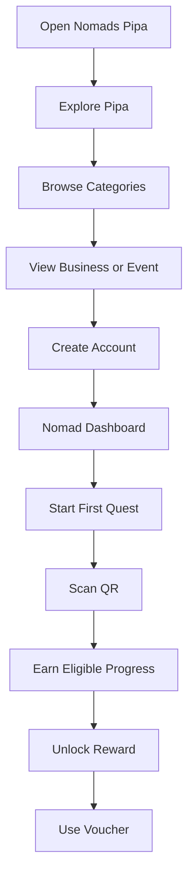

# Frontend Architecture

**Project:** Nomads Pipa  
**File:** `architecture/FRONTEND.md`  
**Status:** Draft  
**Stack:** Next.js, TypeScript, Tailwind CSS, shadcn/ui, Supabase

---

## 1. Purpose

This document defines the frontend architecture for Nomads Pipa.

The frontend must support three connected experiences:

1. **Nomad experience:** Discover Pipa, find activities and services, join community events, complete quests, and use vouchers.
2. **Partner experience:** Manage business listings, create offers, operate the Traffic Router, and review performance.
3. **Staff experience:** Scan and validate QR codes and vouchers through a simplified interface.

The application should be mobile-first, installable as a Progressive Web App (PWA), and straightforward for a solo developer to maintain.

## 2. Frontend Principles

- Mobile-first responsive design.
- Fast access to useful local information.
- Simple navigation with minimal cognitive load.
- Reusable components instead of duplicated screens.
- Clear separation between public, authenticated, partner, and staff experiences.
- Accessible controls and readable typography.
- Server-side data fetching where appropriate.
- Secure authentication and permission checks.
- Progressive enhancement for unreliable mobile connections.

The product should feel like a useful local companion rather than a conventional business directory.

## 3. Technology Stack

| Technology          | Responsibility                            |
| ------------------- | ----------------------------------------- |
| Next.js App Router  | Routing, rendering, and server-side logic |
| TypeScript          | Type safety                               |
| Tailwind CSS        | Styling and responsive layouts            |
| shadcn/ui           | Accessible reusable UI components         |
| Supabase Auth       | Authentication                            |
| Supabase PostgreSQL | Application data                          |
| Supabase Storage    | Images and uploaded content               |
| Zod                 | Form and API validation                   |
| React Hook Form     | Complex forms                             |
| Lucide Icons        | Interface icons                           |

Avoid introducing additional libraries unless they solve a clear product requirement.

## 4. Application Structure

Use Next.js App Router.

Recommended structure:

```text
src/
  app/
    (public)/
      page.tsx
      discover/
      category/
      businesses/
      events/
      about/
      partner/
    (auth)/
      login/
      register/
      forgot-password/
    (nomad)/
      layout.tsx
      dashboard/
      quests/
      inventory/
      wallet/
      profile/
      settings/
    (partner)/
      partner/
        layout.tsx
        dashboard/
        business/
        flash-drops/
        qr-codes/
        analytics/
        team/
    staff/
      scanner/
    api/
      v1/
  components/
    ui/
    layout/
    navigation/
    discovery/
    business/
    events/
    quests/
    wallet/
    scanner/
    partner/
  lib/
    supabase/
    auth/
    api/
    validation/
    utils/
  hooks/
  types/
  styles/
```

Route groups in parentheses organise the application without adding URL segments.

The actual URL structure should remain simple and predictable.

## 5. Navigation Architecture

Navigation is one of the most important product decisions.

Users must be able to discover the main categories without scrolling through an incomplete list or opening several menus.

### 5.1 Public navigation

Recommended desktop navigation:

- Explore
- Categories
- Events
- Community
- About
- Become a Partner

Primary CTA: **Join Nomads Pipa**

On mobile, use a compact header and a persistent bottom navigation.

### 5.2 Nomad bottom navigation

<text weight="semibold" color="default">Recommended mobile navigation</text>

<box border radius="xl" padding={3} gap={3}>
  <grid columns={5} gap={1}>
    <grid-item>
      <box align="center" gap={1}>
        <icon name="compass" size="xl"/>
        <text size="xs" weight="medium">Explore</text>
      </box>
    </grid-item>
    <grid-item>
      <box align="center" gap={1}>
        <icon name="calendar-days" size="xl"/>
        <text size="xs">Events</text>
      </box>
    </grid-item>
    <grid-item>
      <box align="center" gap={1}>
        <icon name="swords" size="xl"/>
        <text size="xs">Quests</text>
      </box>
    </grid-item>
    <grid-item>
      <box align="center" gap={1}>
        <icon name="ticket" size="xl"/>
        <text size="xs">Wallet</text>
      </box>
    </grid-item>
    <grid-item>
      <box align="center" gap={1}>
        <icon name="user-round" size="xl"/>
        <text size="xs">Profile</text>
      </box>
    </grid-item>
  </grid>
  <caption color="secondary" textAlign="center">Illustrative navigation layout, not a final visual design.</caption>
</box>

The bottom navigation should remain consistent across the authenticated nomad experience.

Inventory can be accessed through Quests or Profile rather than adding another permanent navigation item.

### 5.3 Partner navigation

Partner dashboard navigation:

- Overview
- Business Profile
- Traffic Router
- Flash Drops
- Analytics
- Team & Access
- Settings

On mobile, use a collapsible menu or compact navigation.

### 5.4 Staff navigation

The staff interface should be independent from the main consumer navigation.

It should have only:

- Scanner.
- Recent redemption result.
- Business identity.
- Sign out.

Avoid exposing the full partner dashboard to staff users.

## 6. Main User Journeys

### 6.1 New nomad journey



Important: browsing should be available before registration. Require login only when a feature needs a user account.

### 6.2 Returning nomad journey

1. Open the PWA.
2. See relevant events and offers.
3. Check current quest progress.
4. Discover a business or activity.
5. Scan a QR or claim an eligible offer.
6. Review wallet and achievements.

### 6.3 Partner journey

1. Open Become a Partner.
2. Submit a partner application.
3. Receive approval and account access.
4. Complete business profile.
5. Set up QR codes and quests with platform support.
6. Create Flash Drops.
7. Review traffic and redemption analytics.

### 6.4 Staff journey

1. Open `/staff/scanner`.
2. Sign in with an assigned staff account.
3. Select the permitted business if multiple memberships exist.
4. Scan a voucher QR.
5. View the validation result.
6. Confirm the result to the customer.
7. Continue scanning.

## 7. Page Specifications

### 7.1 Homepage / Explore

**Route:** `/`

Purpose: Help users quickly answer, "What can I do in Pipa?"

Recommended sections:

1. Hero area with a concise value proposition.
2. Search or discovery input.
3. Today's highlights.
4. Browse all categories.
5. Events happening today.
6. Featured local businesses.
7. Community picks.
8. Active Flash Drops.
9. Partner CTA.

The category section must expose all primary categories, not only a few featured options.

Recommended category cards:

- Food & Drink.
- Accommodation.
- Transportation.
- Events & Community.
- Sports & Activities.
- Essential Services.
- Community & Give Back.

Use a grid with a visible "View all categories" option.

### 7.2 Category discovery

**Route:** `/category/[slug]`

Each category page should include:

- Category title and short description.
- Relevant filters.
- Featured options.
- Business or service cards.
- Contextual recommendations.
- Clear enquiry or contact CTA when applicable.

Example: Food & Drink filters could include:

- Remote-work friendly.
- Vegan options.
- Daily meals.
- Sunset views.
- Live music.
- Nightlife.
- Delivery.

Do not build a full map-first directory for the MVP. Prioritise useful filters and curated recommendations.

### 7.3 Business detail

**Route:** `/businesses/[slug]`

Display:

- Business name and images.
- Category and tags.
- Description.
- Location and contact options.
- Opening hours, if maintained.
- Relevant offers.
- QR or quest participation information where applicable.

Primary CTA depends on business type:

- Visit Website.
- WhatsApp.
- Get Directions.
- Book or Enquire.
- View Offer.

Only show actions that the business has configured and verified.

### 7.4 Events

**Route:** `/events`

The events page should answer:

**"If I want to meet people today, where should I go?"**

Display events by date and category.

Event types must be visually distinguishable:

| Type                | Meaning                                                  |
| ------------------- | -------------------------------------------------------- |
| Nomads Pipa Meet-up | Official community event                                 |
| Community Pick      | Third-party event with community members confirmed going |
| City Event          | General Pipa event or cultural suggestion                |

Each event card should include:

- Event name.
- Date and time.
- Location.
- Event type.
- Description.
- Attendance or community information where available.
- External link or RSVP CTA.

Do not imply that a third-party event is officially organised by Nomads Pipa.

### 7.5 Nomad dashboard

**Route:** `/dashboard`

Purpose: Provide a personalised overview.

Recommended sections:

- Welcome message.
- Current quest progress.
- Recommended next action.
- Available vouchers.
- Today's events.
- Active Flash Drops.
- Recent achievements.

Avoid overwhelming the user with too many statistics.

### 7.6 Quest Tree

**Route:** `/quests`

The Quest Tree is the main gamification interface.

<AsyncImage query="modern mobile RPG quest tree interface branching progression nodes fantasy adventure game UI clean minimal dark interface" aspectRatio="16:9" width="100%"/>

Display:

- Available quests.
- Locked quests.
- Active quests.
- Completed quests.
- Progress indicators.
- Rewards.
- Required actions.

Quest states:

| State            | Presentation            |
| ---------------- | ----------------------- |
| Locked           | Disabled or muted       |
| Available        | Clear start action      |
| Active           | Progress indicator      |
| Completed        | Completion indicator    |
| Reward available | Highlight reward action |

For MVP, use a simple vertical or branching progression layout. Avoid building a complex interactive game engine.

### 7.7 Inventory

**Route:** `/inventory`

Display unlocked digital achievements and collectible artwork.

Each item should have:

- Image.
- Name.
- Description.
- Date unlocked.
- Rarity or category if applicable.

Inventory items are collectibles, not necessarily redeemable vouchers.

### 7.8 Voucher wallet

**Route:** `/wallet`

Separate active vouchers from redeemed and expired vouchers.

Each voucher card should show:

- Business.
- Offer.
- Expiry.
- Redemption instructions.
- QR code or redemption token when needed.
- Status.

Do not show a reusable personal voucher token in public profile screens.

### 7.9 Profile and settings

**Route:** `/profile`

Include:

- Display name.
- Profile image.
- Preferred language.
- Community preferences.
- Account settings.
- Privacy controls.
- Sign out.

Keep private contact information hidden from public profile views.

## 8. Partner Dashboard

**Base route:** `/partner`

The partner experience should focus on measurable business value.

### 8.1 Overview

Display:

- Total scans.
- Unique visitors.
- Voucher redemptions.
- Quest participation.
- Active Flash Drops.
- Recent activity.

Use simple charts and summaries rather than an overly complex analytics interface.

### 8.2 Business profile

**Route:** `/partner/business`

Allow authorised managers and owners to update:

- Business name.
- Description.
- Category.
- Tags.
- Images.
- Contact details.
- Website and social links.
- Location.
- Opening hours.

Changes to public-facing information may require admin approval, depending on the moderation workflow.

### 8.3 Traffic Router

**Route:** `/partner/traffic-router`

The Traffic Router dashboard should show:

- Active QR campaigns.
- QR codes associated with the business.
- Total scans.
- Scan history.
- Quest participation.
- Voucher activity.

Keep the main actions obvious:

- View QR codes.
- Create or manage a campaign.
- View performance.

### 8.4 Flash Drop creation

**Route:** `/partner/flash-drops/new`

Form fields:

- Offer title.
- Offer description.
- Reward or discount.
- Start time.
- Expiry time.
- Maximum claims.
- Optional proximity radius.
- Eligible audience.

For MVP, use a simple default claim limit of 10.

Show a confirmation summary before publishing.

### 8.5 Analytics

**Route:** `/partner/analytics`

Recommended visualisations:

- QR scans over time.
- Unique visitors.
- Voucher redemption rate.
- Quest completion count.
- Flash Drop claim performance.

All metrics must be based on business-authorised data.

## 9. Staff Scanner Interface

**Route:** `/staff/scanner`

<AsyncImage query="minimal mobile QR code scanner application interface smartphone camera scan voucher verification green success check interface" aspectRatio="16:9" width="100%"/>

The staff scanner must prioritise speed and clarity.

### Main states

1. Not authenticated.
2. Camera permission required.
3. Ready to scan.
4. Scanning.
5. Valid voucher.
6. Invalid voucher.
7. Already redeemed.
8. Expired voucher.
9. Network unavailable.

### UX requirements

- Large scan area.
- Clear camera permission instructions.
- Strong visual result states.
- Minimal text.
- Large touch targets.
- Manual fallback for supported token entry if camera access fails.
- Clear retry action for network errors.

Never display a success state until the server confirms redemption.

The scanner must be authenticated and restricted to the assigned business.

## 10. Reusable Components

Build shared components early.

| Component         | Purpose                 |
| ----------------- | ----------------------- |
| `AppHeader`       | Main navigation header  |
| `MobileBottomNav` | Nomad mobile navigation |
| `CategoryCard`    | Category discovery      |
| `BusinessCard`    | Business preview        |
| `EventCard`       | Event preview           |
| `OfferCard`       | Flash Drop preview      |
| `QuestCard`       | Quest summary           |
| `QuestProgress`   | Progress indicator      |
| `VoucherCard`     | Voucher wallet item     |
| `AchievementCard` | Inventory collectible   |
| `QRCodeDisplay`   | Secure token display    |
| `QRScanner`       | Camera scanning         |
| `StatusBadge`     | Status indicator        |
| `EmptyState`      | Empty lists             |
| `ErrorState`      | Error feedback          |
| `LoadingState`    | Loading feedback        |
| `SearchBar`       | Discovery search        |
| `FilterPanel`     | Category filters        |

Use shadcn/ui primitives where appropriate rather than creating custom controls for everything.

## 11. Design System

### Visual direction

Nomads Pipa should feel:

- Local.
- Friendly.
- Contemporary.
- Social.
- Adventurous.
- Trustworthy.

Avoid making the directory look like a corporate SaaS dashboard. The partner dashboard can be more functional while maintaining the same brand identity.

### Official Brand Colours and Tokens

The Nomads Pipa design system is defined using Tailwind CSS v4 `@theme inline` in `app/globals.css`. It features seven core brand colours and supporting tints:

| Brand Token | Hex Code | Intended Role |
| ----------- | -------- | ------------- |
| `ocean` (`--color-ocean`) | `#073F3B` | Primary authority and action. Main headers, primary CTAs, active navigation items. |
| `lagoon` (`--color-lagoon`) | `#00A896` | Friendly interaction, highlights, active status, focus rings. |
| `lagoon-tint` (`--color-lagoon-tint`) | `#DDF3EF` | Soft background tint for quick tiles and badges (~12–15% fill). |
| `sun` (`--color-sun`) | `#F5C842` | Events, community highlights, ratings, delight. |
| `sun-tint` (`--color-sun-tint`) | `#FFF3D1` | Light callout card fills. |
| `coral` (`--color-coral`) | `#FF6B4A` | Secondary CTAs, urgency, active highlights, map hot pins. |
| `coral-tint` (`--color-coral-tint`) | `#FFE6DC` | Soft coral background tint for tiles and tags. |
| `coral-dark` (`--color-coral-dark`) | `#E8502F` | Higher contrast coral variation for small text or pressed states. |
| `sand` (`--color-sand`) | `#FFF6EB` | Official default page background. Warm and sunlit, avoiding clinical white. |
| `charcoal` (`--color-charcoal`) | `#1F2937` | Default copy text, icons, headings on light surfaces (never pure black). |
| `mist` (`--color-mist`) | `#E5E7EB` | Hairline borders, dividers, disabled states, unselected chips. |

#### Semantic shadcn/ui Mapping

The following semantic CSS variables are mapped in `:root` and bound via `@theme inline`:

- `background`: Sand (`#FFF6EB`)
- `foreground`: Charcoal (`#1F2937`)
- `card` & `card-foreground`: White (`#FFFFFF`) & Charcoal (`#1F2937`)
- `popover` & `popover-foreground`: White (`#FFFFFF`) & Charcoal (`#1F2937`)
- `primary` & `primary-foreground`: Ocean Green (`#073F3B`) & White (`#FFFFFF`)
- `secondary` & `secondary-foreground`: Coral (`#FF6B4A`) & Charcoal (`#1F2937`) *(accessibility: Charcoal provides WCAG AA contrast on Coral)*
- `accent` & `accent-foreground`: Lagoon Teal (`#00A896`) & Charcoal (`#1F2937`) *(accessibility: Charcoal provides WCAG AA contrast on Lagoon Teal)*
- `muted` & `muted-foreground`: Mist (`#E5E7EB`) & Charcoal 65% (`#4B5563`)
- `border` & `input`: Mist (`#E5E7EB`)
- `ring`: Lagoon Teal (`#00A896`)
- `sun` & `sun-foreground`: Sun Yellow (`#F5C842`) & Charcoal (`#1F2937`)
- `destructive` & `destructive-foreground`: Semantic red (`#DC2626`) & White (`#FFFFFF`) — kept separate from brand Coral.

### Typography

Typography is loaded in `app/layout.tsx` via `next/font/google` and exposed as CSS variables:

- **Inter** (`--font-inter`): Default sans-serif interface font (`--font-sans`). Used for body copy, UI controls, navigation, and inputs.
- **Sora** (`--font-sora`): Geometric display sans-serif (`--font-display` / `--font-heading`). Used for hero titles, section headings, and display typography.

Typographic hierarchy:
- Hero display: 32–36px, Sora Bold (700)
- Screen title (H1): 24px, Sora Bold (700)
- Section / card title (H2): 18–20px, Sora Semibold (600)
- Card title (H3): 16px, Inter/Sora Semibold (600)
- Body text: 14–16px, Inter Regular (400)
- Secondary / meta info: 12–13px, Inter (400–500)
- Tags / chips / nav: 10–12px, Inter Medium/Semibold (500–600)

### Shape, Spacing and Elevation

- **Base radius:** `--radius: 1.25rem` (20px).
- **Buttons and chips:** Full pill (`rounded-full`).
- **Cards:** 20–24px corner radii (`rounded-2xl`).
- **Quick-action tiles:** 16–20px radii (`rounded-xl` / `rounded-2xl`).
- **Shadows:** Soft, green-tinted shadows:
  - `shadow-card`: `0 4px 20px rgba(7, 63, 59, 0.08)`
  - `shadow-float`: `0 8px 24px rgba(7, 63, 59, 0.12)`
- **Spacing rhythm:** 4px grid steps (common: 8px, 12px, 16px, 20px, 24px, 32px).

### Brand Assets

Official vector artwork and brand assets belong in `public/brand/`:
- `public/brand/README.md` documents asset guidelines and naming conventions.
- As of NP-017, official logo and badge vector files are pending delivery. Placeholders or synthesized substitutes must not be used.
- Browser `themeColor` is set to Ocean Green (`#073F3B`).

### How Future Developers Should Use Tokens

1. **Colors:** Use Tailwind brand tokens directly (`bg-ocean`, `text-charcoal`, `border-mist`, `bg-sand`, `bg-lagoon-tint`) or semantic classes (`bg-primary`, `text-primary-foreground`, `bg-background`). Do not hardcode hex codes.
2. **Typography:** Body text automatically inherits `font-sans` (Inter). Apply `font-heading` or `font-display` to headings (`<h1 className="font-heading text-2xl font-bold text-ocean">...</h1>`).
3. **Accessibility:** Avoid small white text on Coral or Lagoon Teal; use Charcoal text or bold text >= 16px. Primary action should pair White text with Ocean Green (`bg-primary text-primary-foreground`).

## 12. Responsive Design

Design mobile layouts first.

### Breakpoint behaviour

| Screen  | Behaviour                                         |
| ------- | ------------------------------------------------- |
| Mobile  | Single column, bottom navigation                  |
| Tablet  | Two-column layouts where appropriate              |
| Desktop | Wider grids and sidebar navigation for dashboards |

Important requirements:

- No horizontal scrolling.
- Touch targets should be comfortably sized.
- Forms must remain usable on small screens.
- QR scanning must work on supported mobile browsers.
- Partner tables should become cards or horizontally scrollable regions where necessary.

## 13. PWA Requirements

Nomads Pipa should be installable on supported mobile devices.

### MVP requirements

- Web app manifest.
- Application name and icons.
- Theme colour.
- Standalone display mode.
- Appropriate mobile viewport.
- HTTPS deployment.

### Offline strategy

For MVP, offline support should be limited to safe, read-only experiences.

Potential offline content:

- Previously viewed public listings.
- Static category information.
- Previously loaded event information.

Do not allow offline voucher redemption, reward issuance, or QR validation.

These actions require server confirmation.

A later phase may introduce carefully controlled background synchronisation for non-sensitive actions.

## 14. Data Fetching and State Management

Use server components for public content and initial page data where practical.

Use client components for interactive features such as:

- QR scanning.
- Search filters.
- Form interactions.
- Quest progress interactions.
- Voucher actions.
- Dashboard controls.

### State management principles

- Use URL search parameters for shareable filters.
- Use React state for local UI state.
- Use Supabase for persistent application data.
- Avoid introducing a global state library until there is a demonstrated need.
- Do not store authentication tokens manually in local storage.

### Loading and error states

Every data-driven page should have:

- Loading state.
- Empty state.
- Error state.
- Success feedback where relevant.

Avoid blank pages when requests fail.

## 15. Forms and Validation

Use React Hook Form and Zod for forms with multiple fields or validation rules.

Important forms:

- Registration.
- Login.
- Partner application.
- Business profile editing.
- Accommodation enquiry.
- Concierge enquiry.
- Flash Drop creation.
- Profile settings.

Validation must happen both in the frontend and on the server.

Provide clear, actionable error messages.

Do not clear user input unnecessarily after a failed submission.

## 16. Accessibility

The frontend should follow practical accessibility standards.

Requirements:

- Semantic HTML.
- Keyboard-accessible navigation.
- Visible focus states.
- Accessible form labels.
- Sufficient colour contrast.
- Alternative text for meaningful images.
- Screen-reader labels for icon-only controls.
- Clear error messages.
- No reliance on colour alone to communicate status.

Use accessible shadcn/ui components as the starting point.

## 17. Performance

Prioritise fast mobile loading.

Requirements:

- Use Next.js image optimisation.
- Resize and compress uploaded images.
- Lazy-load below-the-fold content.
- Avoid unnecessary client-side JavaScript.
- Paginate large lists.
- Avoid fetching the same data repeatedly.
- Use caching for appropriate public content.
- Keep interactive bundles small.

Do not cache private voucher or user-specific data in shared public caches.

## 18. Analytics and Frontend Events

Track product usage through a privacy-conscious analytics approach.

Suggested events:

- `business_viewed`
- `category_opened`
- `event_viewed`
- `quest_started`
- `qr_scan_submitted`
- `quest_completed`
- `voucher_viewed`
- `voucher_redeemed`
- `flash_drop_viewed`
- `flash_drop_claimed`
- `partner_application_submitted`

Do not send QR tokens, passwords, private profile details, or precise GPS coordinates to analytics systems.

Database records remain the source of truth for scans, redemptions, and rewards.

## 19. MVP Build Order

Build the frontend in the following sequence:

| Phase | Screens                                  |
| ----- | ---------------------------------------- |
| 1     | Global layout, header, mobile navigation |
| 2     | Homepage and category discovery          |
| 3     | Business listings and business details   |
| 4     | Events and community pages               |
| 5     | Authentication and profile               |
| 6     | Nomad dashboard                          |
| 7     | Quest Tree and inventory                 |
| 8     | Voucher wallet                           |
| 9     | Staff scanner                            |
| 10    | Partner dashboard                        |
| 11    | Flash Drop creation                      |
| 12    | Partner analytics                        |

The consumer discovery experience should be usable before the full gamification system is implemented.

## 20. Definition of Done

The frontend architecture is ready for MVP when:

- Public and authenticated routes are separated.
- Nomad, partner, and staff experiences have distinct layouts.
- Mobile navigation is implemented.
- All primary categories are discoverable.
- Business and event cards use reusable components.
- Forms have frontend and server-side validation.
- Protected screens validate authentication.
- Partner screens enforce business permissions through the backend.
- Staff scanner requires authentication.
- Loading, empty, error, and success states are implemented.
- PWA installation requirements are met.
- Sensitive actions require server confirmation.
- The interface works across supported mobile and desktop screen sizes.

---
