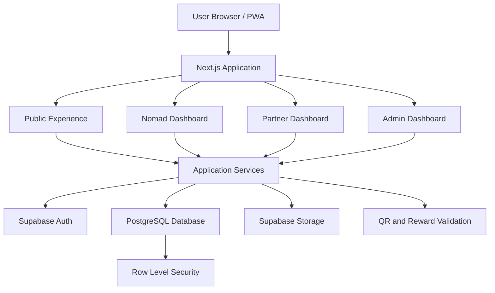
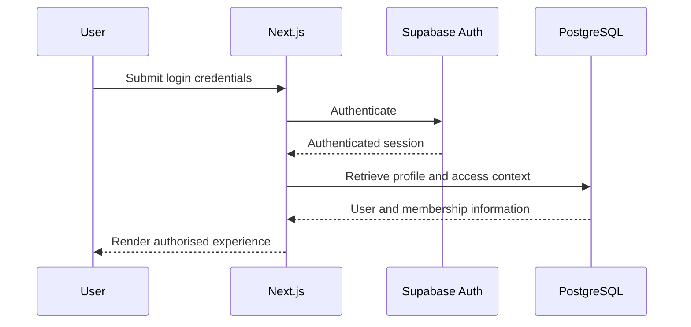
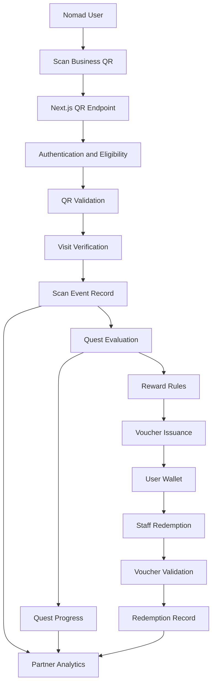
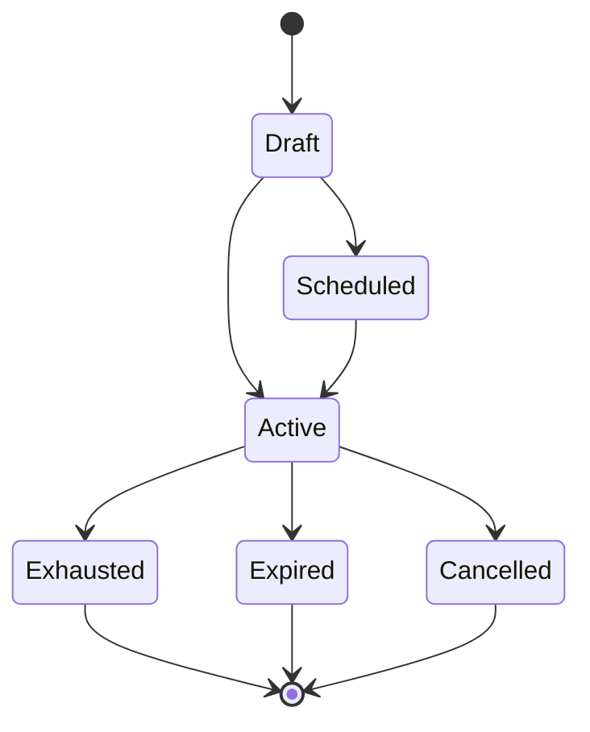
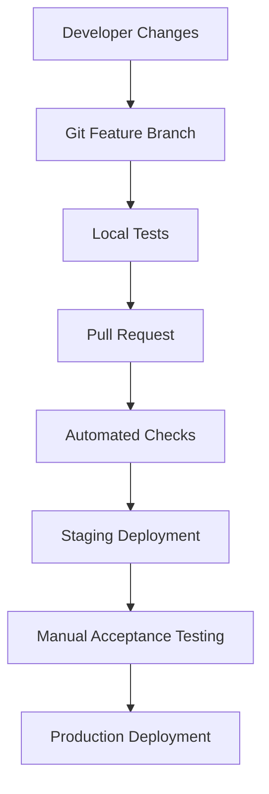

# Nomads Pipa — System Architecture

**File:** `docs/SYSTEM_ARCHITECTURE.md`
**Version:** 1.0  
**Status:** Draft  
**Last updated:** 2026-11-02

---

# 1. Architecture Overview

## 1.1 Purpose

This document defines the high-level technical architecture of Nomads Pipa.

It describes:

- The application structure.
- The relationship between Next.js and Supabase.
- The main product modules.
- Authentication and authorisation.
- Data flow between users, businesses, and platform services.
- The Traffic Router architecture.
- Security boundaries.
- Deployment and operational requirements.

The goal is to provide a maintainable foundation for the MVP without introducing unnecessary infrastructure.

## 1.2 Architectural approach

Nomads Pipa will use a **modular monolith architecture**.

The application will consist of:

- One Next.js application.
- One Supabase project.
- One PostgreSQL database.
- A set of logically separated feature modules.
- Shared UI and infrastructure components.

Each feature should have a clear responsibility and should communicate with other features through well-defined service functions and database relationships.

The MVP will not use microservices.

### Why a modular monolith?

A modular monolith provides:

- Simpler deployment.
- Lower operational overhead.
- Easier debugging.
- Shared authentication.
- Consistent data access.
- Fewer infrastructure dependencies.
- A straightforward path for a solo developer.

Features can be separated into independent services later if a real scaling or operational need emerges.

---

# 2. Technology Stack

## 2.1 Required stack

| Layer                 | Technology       | Responsibility                                       |
| --------------------- | ---------------- | ---------------------------------------------------- |
| Application framework | Next.js          | Routing, rendering, server functionality.            |
| Programming language  | TypeScript       | Type safety.                                         |
| Styling               | Tailwind CSS     | Layout and responsive styling.                       |
| UI components         | shadcn/ui        | Accessible reusable components.                      |
| Backend platform      | Supabase         | Authentication, database, storage, backend services. |
| Database              | PostgreSQL       | Relational application data.                         |
| Authentication        | Supabase Auth    | User authentication.                                 |
| Storage               | Supabase Storage | Images and uploaded assets.                          |
| Hosting               | Vercel           | Next.js application deployment.                      |
| Source control        | GitHub           | Code and migration version control.                  |

## 2.2 Application architecture



The diagram represents logical responsibilities. It does not require a separate deployment for each dashboard.

---

# 3. Main Application Areas

Nomads Pipa has four primary application areas.

## 3.1 Public experience

The public experience should allow visitors to access useful local information without creating an account.

### Main routes

| Route                  | Purpose                                 |
| ---------------------- | --------------------------------------- |
| `/`                    | Homepage.                               |
| `/discover`            | Discovery Hub.                          |
| `/discover/[category]` | Category listing.                       |
| `/businesses/[slug]`   | Business detail page.                   |
| `/events`              | Events calendar.                        |
| `/events/[slug]`       | Event detail page.                      |
| `/accommodation`       | Accommodation discovery.                |
| `/transport`           | Transportation information.             |
| `/activities`          | Sports and activities.                  |
| `/essential-services`  | Essential local services.               |
| `/community`           | Community links and initiatives.        |
| `/about`               | About Nomads Pipa and founder profiles. |
| `/blog`                | Editorial content.                      |
| `/blog/[slug]`         | Article detail.                         |
| `/partners`            | Become a Partner page.                  |
| `/concierge`           | Concierge services.                     |

Public pages should use server rendering or static generation where appropriate.

Public directory content should be accessible to search engines.

## 3.2 Nomad dashboard

The authenticated user experience.

### Main routes

| Route                  | Purpose                        |
| ---------------------- | ------------------------------ |
| `/dashboard`           | User overview.                 |
| `/dashboard/profile`   | Profile management.            |
| `/dashboard/quests`    | Available quests and progress. |
| `/dashboard/wallet`    | Vouchers and rewards.          |
| `/dashboard/inventory` | Digital achievements.          |
| `/dashboard/history`   | User activity history.         |

The dashboard should provide quick access to active quests, available rewards, upcoming events, and useful saved information.

For MVP launch, dashboard sections may be introduced progressively.

## 3.3 Partner dashboard

The authenticated business experience.

### Main routes

| Route                | Purpose                     |
| -------------------- | --------------------------- |
| `/partner`           | Partner dashboard overview. |
| `/partner/business`  | Business profile.           |
| `/partner/offers`    | Offer management.           |
| `/partner/quests`    | Participating quests.       |
| `/partner/analytics` | Performance metrics.        |
| `/partner/staff`     | Staff access management.    |
| `/partner/settings`  | Partner settings.           |

A partner user may belong to one or more businesses.

The application must determine which business context the user is currently managing.

## 3.4 Staff scanner

The staff scanner is a simplified experience.

### Main routes

| Route                    | Purpose                              |
| ------------------------ | ------------------------------------ |
| `/staff`                 | Staff landing page.                  |
| `/staff/scan`            | QR scanning.                         |
| `/staff/redemption/[id]` | Redemption result where appropriate. |

Staff should not have access to the complete partner dashboard.

The scanner should be designed for fast operation on mobile devices.

## 3.5 Admin dashboard

### Main routes

| Route               | Purpose                             |
| ------------------- | ----------------------------------- |
| `/admin`            | Platform overview.                  |
| `/admin/businesses` | Business management.                |
| `/admin/partners`   | Partner applications and approvals. |
| `/admin/categories` | Directory categories.               |
| `/admin/events`     | Event management.                   |
| `/admin/content`    | Editorial and page content.         |
| `/admin/quests`     | Quest management.                   |
| `/admin/offers`     | Platform offer management.          |
| `/admin/users`      | User management.                    |
| `/admin/audit`      | Important platform activity.        |

Administrative routes must be protected by server-side role checks.

---

# 4. Feature Module Architecture

The application should be organised around product capabilities rather than technical layers alone.

## 4.1 Core modules

| Module             | Responsibility                             |
| ------------------ | ------------------------------------------ |
| Authentication     | Registration, login, session handling.     |
| Profiles           | User profile information.                  |
| Discovery          | Categories, search, directory browsing.    |
| Businesses         | Business listings and business profiles.   |
| Events             | Community and city events.                 |
| Accommodation      | Accommodation discovery and enquiries.     |
| Transportation     | Transport options and enquiries.           |
| Activities         | Sports and experiences.                    |
| Essential Services | Local service information.                 |
| Community          | Community links and Give Back initiatives. |
| Partners           | Partner applications and dashboard.        |
| Quests             | Quest definitions and progress.            |
| QR                 | QR code generation and validation.         |
| Vouchers           | Voucher issuance and redemption.           |
| Offers             | Business offers and Flash Drops.           |
| Analytics          | Usage and partner reporting.               |
| Administration     | Content and platform management.           |
| Concierge          | Enquiries and service packages.            |

## 4.2 Suggested source structure

```text
src/
├── app/
│   ├── (public)/
│   │   ├── page.tsx
│   │   ├── discover/
│   │   ├── businesses/
│   │   ├── events/
│   │   ├── accommodation/
│   │   ├── transport/
│   │   ├── activities/
│   │   ├── essential-services/
│   │   ├── community/
│   │   ├── about/
│   │   ├── blog/
│   │   └── partners/
│   │
│   ├── (auth)/
│   │   ├── login/
│   │   ├── register/
│   │   └── reset-password/
│   │
│   ├── dashboard/
│   │   ├── page.tsx
│   │   ├── profile/
│   │   ├── quests/
│   │   ├── wallet/
│   │   └── inventory/
│   │
│   ├── partner/
│   │   ├── page.tsx
│   │   ├── business/
│   │   ├── offers/
│   │   ├── analytics/
│   │   └── staff/
│   │
│   ├── staff/
│   │   ├── page.tsx
│   │   └── scan/
│   │
│   ├── admin/
│   │   ├── page.tsx
│   │   ├── businesses/
│   │   ├── partners/
│   │   ├── events/
│   │   ├── content/
│   │   ├── quests/
│   │   └── users/
│   │
│   └── api/
│       ├── qr/
│       ├── vouchers/
│       └── enquiries/
│
├── components/
│   ├── ui/
│   ├── layout/
│   ├── navigation/
│   ├── forms/
│   └── shared/
│
├── features/
│   ├── auth/
│   ├── profiles/
│   ├── discovery/
│   ├── businesses/
│   ├── events/
│   ├── partners/
│   ├── quests/
│   ├── qr/
│   ├── vouchers/
│   ├── offers/
│   ├── analytics/
│   └── admin/
│
├── lib/
│   ├── supabase/
│   ├── auth/
│   ├── permissions/
│   ├── validation/
│   └── utils/
│
├── config/
├── types/
└── styles/
```

This is a reference structure. Do not create empty folders for features that have not started.

## 4.3 Module boundaries

Each feature module should contain only the functionality it owns.

Example:

```text
features/
└── vouchers/
    ├── components/
    ├── actions/
    ├── queries/
    ├── schemas/
    ├── types/
    └── utils/
```

Responsibilities:

- `components`: Feature-specific UI.
- `actions`: Server-side mutations.
- `queries`: Data retrieval.
- `schemas`: Input validation.
- `types`: Feature-specific TypeScript types.
- `utils`: Pure reusable business logic.

Shared components should not contain business-specific validation rules.

---

# 5. Next.js Application Responsibilities

Next.js provides the application and server-side execution environment.

## 5.1 Server Components

Use Server Components by default.

Appropriate use cases:

- Public directory pages.
- Business detail pages.
- Event pages.
- Content pages.
- Initial dashboard data.
- Server-side data retrieval.

This reduces unnecessary client-side JavaScript.

## 5.2 Client Components

Use Client Components when browser interaction is required.

Examples:

- QR camera scanning.
- Interactive filters.
- Form state.
- Mobile navigation interactions.
- Location permission requests.
- Client-side feedback and animations.

Avoid converting entire pages into Client Components when only one small section needs interactivity.

## 5.3 Server Actions and Route Handlers

Use Server Actions for appropriate application mutations and Route Handlers for explicit HTTP interfaces.

Examples of mutations:

- Updating a user profile.
- Creating an enquiry.
- Submitting a partner application.
- Updating business information.
- Creating an offer.

Examples of HTTP endpoints:

- QR validation.
- Voucher redemption.
- External integration callbacks.
- Operations that need a defined API response.

Every mutation must validate the authenticated user, input data, and resource permissions.

---

# 6. Supabase Architecture

Supabase provides the backend services.

## 6.1 Supabase Auth

Responsibilities:

- User registration.
- Login.
- Logout.
- Password recovery.
- Session management.
- Authentication identity.

The application should maintain a separate profile record associated with the Supabase Auth user.

Do not treat a user-editable profile field as proof of administrative or partner privileges.

## 6.2 PostgreSQL database

The database is the source of truth for:

- Users and profiles.
- Businesses.
- Business memberships.
- Events.
- Categories.
- Partner applications.
- Quests.
- QR codes.
- Scan events.
- Quest progress.
- Vouchers.
- Redemptions.
- Offers.
- Audit records.

Database constraints should enforce important business rules wherever possible.

## 6.3 Supabase Storage

Use storage for:

- Business logos.
- Business gallery images.
- Profile images.
- Event images.
- Blog images.
- Quest artwork.
- Voucher artwork.

Storage buckets should have explicit access policies.

Public listing images may be stored in public buckets. Private documents and sensitive uploads must use restricted buckets.

## 6.4 Supabase Edge Functions

Use Edge Functions selectively.

Potential uses:

- External integrations.
- Scheduled processing.
- Notification delivery.
- Operations requiring a dedicated server-side execution environment.

Do not create Edge Functions for every application operation. Keep ordinary application logic in Next.js unless a separate execution environment provides a clear benefit.

---

# 7. Authentication & Authorisation

## 7.1 Authentication flow



Use the current recommended Supabase SSR integration for Next.js so authentication state is handled correctly across server and browser contexts.

## 7.2 User roles

Initial platform roles:

- `user`
- `partner`
- `staff`
- `admin`

Roles must be assigned and managed through trusted server-side processes.

## 7.3 Business memberships

A business can have multiple authorised users.

Relationship:

```text
User
  |
  | many-to-many
  |
Business Membership
  |
  | many-to-one
  |
Business
```

A business membership should define:

- User ID.
- Business ID.
- Membership role.
- Status.
- Created date.

Suggested membership roles:

- Owner.
- Manager.
- Staff.

Platform roles and business membership roles are separate concepts.

For example, a user may be a partner at one business and staff at another.

## 7.4 Permission checks

Every protected operation must validate:

1. Is the user authenticated?
2. Does the user have the required platform role?
3. Does the user belong to the relevant business?
4. Does their business membership permit this action?
5. Is the target record within their authorised scope?

Frontend route hiding is not a security mechanism.

Database RLS policies must independently enforce data access.

---

# 8. Traffic Router Architecture

The Traffic Router is a system of related capabilities rather than one feature.

It consists of:

1. QR identification.
2. Scan validation.
3. Visit recording.
4. Quest progression.
5. Reward issuance.
6. Voucher redemption.
7. Partner analytics.

## 8.1 Logical architecture



## 8.2 QR identification

Each participating business can have one or more QR codes.

A QR code should identify a server-managed QR record rather than directly granting a reward.

Recommended properties:

- Unique identifier.
- Associated business.
- Active status.
- Purpose.
- Optional campaign or quest association.
- Creation timestamp.
- Optional expiry.

Do not put sensitive user data, private business information, or reward authority into a QR code.

A QR code is an identifier, not proof that an action is valid.

## 8.3 Scan validation

When a user scans a QR code:

1. The browser reads the QR payload.
2. The client sends the payload to a server endpoint.
3. The server validates the user session.
4. The server looks up the QR record.
5. The server checks that the QR is active.
6. The server evaluates eligibility and applicable duplicate limits.
7. The server evaluates location rules if required.
8. The server records the scan outcome.
9. The server evaluates quest and reward rules.
10. The client receives the result.

The client must not directly insert trusted scan events or reward records.

## 8.4 Location verification

GPS may provide an additional signal for confirming that a user is near a participating business.

However:

- GPS accuracy varies.
- Users can deny location access.
- Browser location data can be unreliable.
- Location alone cannot prove a physical visit.

Use location as one input into an overall validation decision.

For the MVP, location verification can be optional for basic QR visits, with stronger verification applied to campaigns that require it.

## 8.5 Scan event versus quest completion

A scan event records an attempted or completed QR interaction.

A quest completion represents satisfaction of the quest's requirements.

These must be stored separately.

Example:

A user visits a cafe and scans its QR code.

The system:

- Records the scan event.
- Determines whether the scan is valid.
- Checks whether the cafe belongs to an active quest.
- Updates quest progress.
- Issues a reward only if the relevant rule is satisfied.

A scan may be valid without completing a quest.

## 8.6 Reward issuance

Rewards should be created through a central reward service.

This service should:

- Check eligibility.
- Apply reward rules.
- Enforce campaign limits.
- Prevent duplicate issuance.
- Record the reward source.
- Create the voucher record.

The same reward service should support standard rewards and future Golden QR rewards.

## 8.7 Voucher redemption

Voucher redemption must be atomic.

The system should prevent two staff members from redeeming the same voucher simultaneously.

Use a trusted database transaction or equivalent atomic server-side operation to:

1. Validate the voucher.
2. Validate its business association.
3. Check expiry.
4. Check current status.
5. Confirm the staff member's permissions.
6. Mark the voucher redeemed.
7. Record the redemption.

If validation fails, no successful redemption should be recorded.

## 8.8 Idempotency

Important operations must be safe against duplicate requests.

Examples:

- QR scan submissions.
- Reward issuance.
- Voucher redemption.

Use idempotency keys or equivalent unique request identifiers where appropriate.

Database uniqueness constraints should protect against duplicate reward and redemption records.

---

# 9. Flash Drop Architecture

Flash Drops will build on the existing offers and voucher system.

## 9.1 Campaign structure

A Flash Drop should contain:

- Business ID.
- Offer description.
- Start time.
- End time.
- Maximum redemption count.
- Current redemption count or a reliable derived count.
- Eligibility rules.
- Optional proximity radius.
- Campaign status.

## 9.2 Campaign lifecycle



## 9.3 Proximity targeting

Proximity targeting should be treated as a separate capability.

The platform should not send an offer to a user simply because the user once granted location permission.

Location should be requested when necessary, with a clear explanation of why it is needed.

The initial implementation can display active offers to eligible users without automated proximity notifications.

## 9.4 Redemption limits

Redemption limits must be enforced by trusted server-side logic and database operations.

For example, a campaign limited to ten redemptions must never issue an eleventh successful redemption because two users submitted requests simultaneously.

---

# 10. Data Flow Between Product Areas

The main product areas share a common business and user data foundation.

| Source                      | Destination        | Data exchanged                        |
| --------------------------- | ------------------ | ------------------------------------- |
| Discovery                   | Business detail    | Business listing information.         |
| Events                      | User dashboard     | Upcoming and relevant events.         |
| Partner dashboard           | Business records   | Business profile changes.             |
| QR module                   | Scan history       | Scan event records.                   |
| Scan history                | Quest module       | Valid visit events.                   |
| Quest module                | Voucher module     | Eligible reward issuance.             |
| Voucher module              | Staff scanner      | Voucher status and redemption result. |
| Scan and redemption history | Analytics          | Business performance metrics.         |
| Accommodation               | Enquiry management | User accommodation requests.          |
| Partner applications        | Admin dashboard    | Application review information.       |

The database remains the source of truth. UI state and browser storage must not replace authoritative database records.

---

# 11. API & Service Boundaries

Business logic should be centralised into reusable server-side functions.

Suggested service organisation:

```text
features/
├── businesses/
│   ├── queries/
│   └── actions/
├── qr/
│   ├── queries/
│   ├── actions/
│   └── services/
├── quests/
│   ├── queries/
│   ├── actions/
│   └── services/
├── vouchers/
│   ├── queries/
│   ├── actions/
│   └── services/
└── offers/
    ├── queries/
    ├── actions/
    └── services/
```

Examples of service responsibilities:

| Service            | Responsibility                                       |
| ------------------ | ---------------------------------------------------- |
| `businessService`  | Retrieve and update authorised business information. |
| `partnerService`   | Manage partner applications and memberships.         |
| `qrService`        | Validate QR identifiers and process scan requests.   |
| `questService`     | Evaluate quest requirements and progress.            |
| `rewardService`    | Determine and issue eligible rewards.                |
| `voucherService`   | Manage voucher status and redemption.                |
| `offerService`     | Manage partner offers and campaigns.                 |
| `analyticsService` | Retrieve authorised reporting data.                  |

The full request and response contracts will be documented in `architecture/API.md`.

---

# 12. Security Architecture

Security must be enforced across the application and database.

## 12.1 Core requirements

- Supabase Row Level Security on protected tables.
- Server-side validation for sensitive mutations.
- Role-based access checks.
- Business membership checks.
- Input validation.
- Rate limiting for abuse-prone endpoints.
- Secure session handling.
- Environment secret management.
- Audit logging for important operations.

## 12.2 Supabase service role

The Supabase service-role key bypasses Row Level Security.

It must never be exposed in browser code or public environment variables.

If elevated server-side access is needed, it must be isolated within trusted server execution and used only after explicit authorisation checks.

## 12.3 Sensitive operations

The following operations require particular care:

- Partner approval.
- Staff membership changes.
- QR validation.
- Reward issuance.
- Voucher redemption.
- Flash Drop redemption limits.
- Administrative account changes.

## 12.4 Audit history

Important actions should generate audit records.

Examples:

- Partner approved.
- Partner rejected.
- Business profile changed.
- Quest created or modified.
- Reward issued.
- Voucher redeemed.
- Offer activated.
- Staff access revoked.

Audit records should identify the actor, affected resource, action, and timestamp.

Avoid logging passwords, authentication tokens, or unnecessary personal information.

---

# 13. PWA & Browser Architecture

## 13.1 PWA requirements

The application should support:

- Installable web application manifest.
- Appropriate icons.
- HTTPS.
- Mobile-friendly layout.
- Responsive interaction.
- Offline fallback page.

## 13.2 Camera access

The QR scanner requires browser camera permissions.

The application must:

- Explain why camera access is required.
- Handle denied permissions.
- Offer manual code entry.
- Handle unsupported browsers.
- Stop camera use when scanning is complete or the user leaves the scanner.

## 13.3 Geolocation

Location access should be optional unless a specific feature requires it.

The application must:

- Explain why location is requested.
- Request permission at the point of need.
- Handle denied access.
- Handle inaccurate location results.
- Avoid continuous background location tracking.

## 13.4 Offline behaviour

The application may cache suitable public content for improved browsing.

Sensitive operations must remain online:

- QR validation.
- Voucher redemption.
- Reward issuance.
- Partner changes.
- Authentication-sensitive operations.

The system must never show a successful redemption merely because the browser is offline.

---

# 14. Performance & Scalability

## 14.1 Initial performance strategy

- Use Server Components by default.
- Optimise uploaded images.
- Use appropriate Next.js image handling.
- Paginate large datasets.
- Add database indexes for common query patterns.
- Avoid unnecessary client-side dependencies.
- Cache suitable public content.
- Keep dynamic user data appropriately scoped.

## 14.2 Database scalability

The MVP should use PostgreSQL relational tables with clear relationships and constraints.

Potential high-volume tables:

- `scan_events`
- `voucher_redemptions`
- `audit_logs`

These tables should be designed for efficient querying and indexed according to actual access patterns.

Partitioning and advanced database optimisation are not required initially.

## 14.3 Analytics

Avoid calculating every metric by scanning all historical records on every dashboard request.

Start with indexed aggregate queries.

Introduce materialised views or summary tables only when performance or reporting requirements justify them.

---

# 15. Deployment Architecture

## 15.1 Environments

Maintain separate environments for:

- Local development.
- Staging.
- Production.

Production data must not be used casually for development or testing.

## 15.2 Deployment flow



## 15.3 Environment configuration

Configuration should be provided through environment variables.

Examples:

```text
NEXT_PUBLIC_SUPABASE_URL=
NEXT_PUBLIC_SUPABASE_ANON_KEY=
SUPABASE_SERVICE_ROLE_KEY=
```

Only the public Supabase values should be available to browser code.

The service-role key must remain server-side.

## 15.4 Database migrations

Database changes must be version-controlled.

Use Supabase migrations to:

- Create tables.
- Add columns.
- Define relationships.
- Add indexes.
- Define constraints.
- Configure RLS policies.
- Create required database functions.

Avoid making undocumented production-only schema changes through the dashboard.

---

# 16. Monitoring & Operational Requirements

The production platform should monitor:

- Application availability.
- Server errors.
- Failed authentication flows.
- QR validation failures.
- Voucher redemption failures.
- Database errors.
- Important partner actions.

Operational requirements:

- Maintain database backups.
- Document recovery procedures.
- Monitor production deployments.
- Keep dependencies updated.
- Track significant errors.
- Provide a rollback path for problematic releases.

---

# 17. Architecture Decisions & Constraints

The following decisions are the current baseline.

| Decision                 | Selected approach           | Reason                                    |
| ------------------------ | --------------------------- | ----------------------------------------- |
| Application architecture | Modular monolith            | Simple operation and maintenance.         |
| Frontend                 | Next.js                     | Required framework.                       |
| Language                 | TypeScript                  | Type safety.                              |
| Styling                  | Tailwind CSS                | Consistent responsive UI.                 |
| Components               | shadcn/ui                   | Accessible reusable components.           |
| Backend                  | Supabase                    | Integrated backend services.              |
| Database                 | PostgreSQL                  | Relational integrity and transactions.    |
| Authentication           | Supabase Auth               | Integrated identity management.           |
| File storage             | Supabase Storage            | Centralised asset management.             |
| Hosting                  | Vercel                      | Next.js-compatible deployment.            |
| QR processing            | Server-side validation      | Prevent client-side reward manipulation.  |
| Permissions              | RLS plus server-side checks | Defence in depth.                         |
| Offline redemption       | Not supported               | Requires authoritative online validation. |
| Microservices            | Not used for MVP            | Unnecessary operational overhead.         |

---

# 18. Future Architecture Considerations

The architecture should allow future enhancements without requiring them at launch.

Potential additions:

- Push notification infrastructure.
- Automated Flash Drop targeting.
- Advanced geospatial queries.
- Multi-city support.
- More advanced quest progression.
- Reward tiers.
- Portuguese and additional language support.
- Concierge workflow automation.
- External booking integrations.
- Partner subscription and billing.
- Advanced analytics.

These capabilities should be introduced through incremental architectural changes rather than premature infrastructure.

---

# 19. Definition of Done

The architecture is considered implemented when:

- The Next.js application is structured around clear product modules.
- Supabase authentication works correctly.
- Database access is protected by RLS.
- Server-side authorisation is implemented.
- Public and authenticated routes are separated.
- Partner membership permissions work correctly.
- Business data is appropriately isolated.
- Sensitive operations are validated server-side.
- QR and voucher operations have auditable records.
- Database migrations are version-controlled.
- Staging and production environments are established.
- Production deployment and rollback procedures are documented.

**Final architectural principle:** Keep the application simple at the infrastructure level and rigorous at the business-logic level. Nomads Pipa should be easy to maintain while treating permissions, QR verification, rewards, and voucher redemption as critical backend operations.
